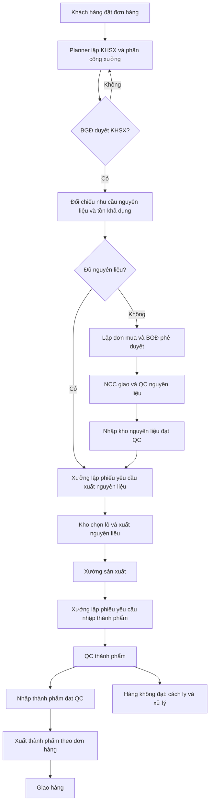

Cập nhật 28/10: user duyệt migration 202610280003_material_location_rules đã APPLIED Docker dev/test và tạo VITRi-A–F tại kho nguyên liệu, sức chứa 2000/1000/2000/1500/3000/500 kg và 24 liên kết vật tư đúng nhóm. Lập/xác nhận/ghi sổ nhập NL vào kho có mapping phải chọn vị trí cho phép; UI lọc theo vật tư QC. Xuất/kiểm kê tồn cũ VT_NVL_KHOITAO vẫn hoạt động, không tự chuyển 20 dòng tồn, không seed pallet/cấp scope; audit marker không overwrite. docs/material_location_layout.md. Không test nghiệp vụ/commit/reset.

Cập nhật danh mục kho 28/10: kho Docker hiện có được đổi tên thành Kho nguyên liệu (MATERIAL), Kho thành phẩm (FINISHED), Kho hàng lỗi (CONTROLLED). Giữ ID, mã nội bộ, loại, vị trí, tồn, chứng từ, sức chứa và scope; kho CONTROLLED vẫn phục vụ nghiệp vụ kiểm soát/cách ly như cũ. Script name-warehouse-catalog.js có guard/transaction/audit và marker chống ghi đè sau khi chạy lại, bootstrap chạy trên volume mới. Không migration, không đổi HTTT02; không test nghiệp vụ. Xem docs/warehouse_catalog_names.md.

Hiện hành 28/10 — phân công cấp nguyên liệu: user đã duyệt migration 202610280002_material_staff_assignment trên Docker dev/test và seed Nguyễn Trọng (nguyentrong), Vũ Thịnh (vuthinh), Trường Thịnh (truongthinh), role/scope kho như nhanvienkho01, không cấp scope xưởng. Phiếu DA_GUI chuyển queue quản lý issues.allocate theo kho (không đòi scope xưởng); quản lý chọn Cung cấp nguyên vật liệu, phiếu, kho và một/nhiều nhân viên. Nhân viên chỉ nhận việc được giao; xuất NL kiểm lại người/kho phân công. Chưa điều phối mới được đổi người; giữ quota/QC/FEFO/reservation/transaction/audit, không ghi tồn khi phân công. Migration đã APPLIED bất biến; seed completion không regrant/unlock. Guide chỉ backend/.artifacts/WAREHOUSE-STAFF-logins.local.md ignored; không password trong docs/log. docs/material_staff_assignment.md. DA_CODE_CHUA_TEST, không test nghiệp vụ/commit/reset.

Cập nhật 28/10/2026: dùng duy nhất tài khoản xưởng `xuong01` quản lý cả ba xưởng XSX002 (Nước giải khát), XSX003 (Trà và nước trái cây), XSX004 (Nước tinh khiết). Mở lại xuong01, giữ mật khẩu và scope kho hiện có; khóa xuong_ngk/xuong_tra/xuong_nuoc và giữ uc01.workshop khóa, thu hồi phiên cả năm tài khoản. Không xóa tài khoản hoặc lịch sử, không gộp thêm xưởng. Script use-shared-workshop-account.js chạy transaction có guard và audit một lần sau consolidate; chạy lại không tự mở khóa/cấp lại scope. Các ghi nhận dùng ba tài khoản riêng bên dưới là lịch sử đã được thay thế. Không migration, không thay tồn/BOM/giá, không test nghiệp vụ/commit/reset.

<!-- PRODUCT_CATALOG_20261023 -->
Hiện hành27/10: còn3xưởng — nước giải khát XSX002, trà/nước trái cây XSX003, nước tinh khiết XSX004. Tài khoản riêng xuong_ngk/xuong_tra/xuong_nuoc nhận đúng phân công; hai tài khoản xưởng chung cũ khóa. Xưởng mẫu đã xóa, lịch/chứng từ được chuyển và audit. [Chi tiết](docs/workshop_consolidation.md), [dữ liệu](data.md). Các số4/5xưởng bên dưới là mốc lịch sử.

Danh mục mua hàng26/10 có9NCC mẫu/48báo giá bao phủ24vật tư, gợi ý NCC phù hợp và giá khi lập mua, ghi chú cuối đơn. Migration/schema và dữ liệu mẫu đã được duyệt, không ghi đè đơn cũ. [Bảng giá](data.md), [thiết kế và bằng chứng](docs/purchase_supplier_design.md). DA_CODE_CHUA_TEST, dữ liệu đồ án hư cấu.

Điều chỉnh mới nhất26/10: mua hàng nhận yêu cầu thiếu vật tư và lập đơn mua **độc lập phạm vi xưởng**; chỉ xem vật tư/lượng thiếu, không phân công/BOM/lịch sản xuất. Không cấp thêm scope, giữ quyền thao tác/nguồn/quota và kiểm soát duyệt đơn. Xem [luồng hiện hành](docs/production_plan_handoff.md). DA_CODE_CHUA_TEST.

Luồng duyệt KHSX26/10: giám đốc quyết định ngay trong chi tiết; đủ vật tư chuyển queue xưởng, thiếu sang yêu cầu mua, từ chối bắt buộc lý do trả lập kế hoạch. Giữ nguyên scope mua hàng theo lựa chọn mới nhất; chưa có người nhận đủ scope báo rõ thay vì báo gửi thành công. Xem [hướng dẫn và giới hạn](docs/production_plan_handoff.md). DA_CODE_CHUA_TEST.

KHSX chờ duyệt hiện có thao tác Sửa cho bộ phận lập kế hoạch; phiếu đã duyệt khóa sửa tại API. Cột “Tình trạng vật tư” hiển thị thiếu/đủ riêng trạng thái duyệt. Số lượng hiển thị hàng nghìn `2.000`, số nguyên `36`. Xem [phạm vi và kiểm tay](docs/production_plan_edit.md). DA_CODE_CHUA_TEST.

UC02 hiện có vật tư tự gợi ý và chỉnh được, tồn mẫu thực trong Docker, xưởng tự chọn theo năng lực và cho đổi. Đã thêm20vật tư/15bộ gợi ý/lịch và scope đúng ba nhóm được duyệt; snapshot vật tư riêng giữ lịch sử kế hoạch. Xem [thiết kế](docs/planning_suggestions_design.md) và [data.md](data.md). Dữ liệu đồ án hư cấu, không công thức nhà sản xuất; chưa nghiệm thu chức năng.

Danh mục hiện hành TP001–TP015 đã được cập nhật trên SQL Server Docker cùng HSD, Lốc6/Thùng24/Pallet60 hoặc80thùng. SKU mẫu cũ khóa và giữ lịch sử. Xem [dữ liệu](data.md) và [quy tắc, kiểm chứng tập trung](docs/product_catalog_update.md). Ngoại lệ kiểm thử mới chỉ dành quy đổi/HSD/lô/FEFO trên warehouse_test, không thay trạng thái nghiệm thu29UC.

<!-- WAREHOUSE_PORTABLE_20261023 -->
## Docker warehouse hiện hành — 23/10/2026

Người dùng đã giao thêm SQL Server container và đổi project Docker thành **warehouse**. Compose mặc định tại root chạy SQL Server2022Developer riêng (SSMS: localhost,14330), db-init/migrate/Express/frontend; app http://localhost:8080, backend3001. Lần đầu chạy `node scripts/setup-docker.js` rồi `docker compose up -d --build`; những lần sau `docker compose up -d`. `scripts/start-docker.ps1` nay dùng bản portable, không phụ thuộc SQL Server Windows/dynamic port. [Hướng dẫn hiện hành](docs/docker_warehouse.md).

Giữ nguyên HTTT02/Windows .env/data và các MySQL/Prisma archives. Chế độ Windows chuyển sang `infra/compose.windows.yaml`/`scripts/start-docker-windows.ps1` (project warehouse-windows); hướng dẫn cũ bên dưới về start-docker dò Windows port là lịch sử đã được thay thế cho chế độ mặc định. Không đồng bộ/copy dữ liệu giữa SQL Server Docker và HTTT02; cả hai có thể mở cùng SSMS. Volumes mới warehouse_sqlserver_data/warehouse_demo_artifacts/warehouse_uploads riêng; credentials riêng local ignored, backend không dùng sa. Seed fixture19accounts trong Docker, không import dữ liệu cũ; seed một lần, không overwrite. Schema76bảng/237FK/native checksum và 29UC giữ nguyên, DA_CODE_CHUA_TEST; chỉ kiểm cú pháp/config/bootstrap/migration/health, không unit/integration/E2E/regression. Không commit/reset/drop/delete volume. Nhóm warehouse-foundation cũ giữ ở trạng thái dừng, không tự xóa.

---

<!-- SQLSERVER_CURRENT_20261016 -->
> Khởi động Docker sau reboot: `powershell -NoProfile -ExecutionPolicy Bypass -File .\scripts\start-docker.ps1`. Script tự dò lại cổng động SQL Server; cổng hiện xác minh52313 (60026 là bằng chứng cũ). App http://localhost:8080, backend Docker3001. Không dùng cổng SQL cũ cố định khi named instance đã đổi cổng.

# Nền tảng hiện hành — SQL Server Windows (16/10/2026)

Express.js + JavaScript CommonJS + mssql12.7.9; Microsoft SQL Server2022 Developer tại `NGUYENTRONG-200\HTTT02`, TCP đã xác minh60026; database warehouse_db và warehouse_test. React/Vite/Tailwind giữ nguyên. **29UC DA_CODE_CHUA_TEST, chưa nghiệm thu; không chạy unit/integration/E2E/regression.**

Đọc [hướng dẫn chạy Windows/SSMS/Docker/migration/backup](docs/sqlserver_runbook.md), [báo cáo chuyển đổi](docs/sqlserver_conversion.md) và [bảng/schema thực tế](docs/sqlserver_schema_manifest.md). Backend native: `cd backend` rồi `npm start`; frontend: `cd frontend` rồi `npm run dev`. Kích hoạt Node24.21.0 bằng `scripts/use-node.ps1` trước. Database đã tạo; không chạy lại bootstrap.

**Các chỉ dẫn MySQL/mysql2/Prisma/InnoDB/utf8mb4 và Compose cũ trong hồ sơ bên dưới là DA_THAY_THE về công nghệ.** Giữ để truy vết quyết định, không thực thi. Mô hình/nghiệp vụ đã duyệt, FS01–FS12 và 29mãUC vẫn có hiệu lực. Dữ liệu MySQL/volumes/migrations cũ giữ nguyên, chưa import sang SQL Server.

---

# HỆ THỐNG QUẢN LÝ KHO NHÀ MÁY NƯỚC NGỌT ĐÓNG CHAI / LON

> **Tài liệu khởi động dự án và chỉ dẫn cho AI lập trình (Codex).**
>
> **Trạng thái hiện tại: GIAI ĐOẠN 2 — ĐÃ GIAO TOÀN BỘ29UC TRONG MỘT NHIỆM VỤ; FS01–FS12 ĐÃ DUYỆT. 29 UC DA_CODE_CHUA_TEST NGÀY16/10/2026; CHƯA KIỂM THỬ VÀ NGHIỆM THU TOÀN HỆ THỐNG.**
>
> Người dùng là **người duy nhất phát triển và nghiệm thu**, có **một AI lập trình hỗ trợ**. Theo lệnh15/10/2026: triển khai liên tục29UC, không dừng từng UC; không chạy unit/integration/E2E/regression trong đợt code này. Giữ test hiện có, không tự tuyên bố PASS hoặc nghiệm thu.

Bàn giao hiện hành16/10: [chạy ứng dụng/demo/kiểm tay29UC](docs/full_system_handoff.md), [API/bảng/module/files](docs/full_system_manifest.md), [checkpoint thực tế](docs/full_system_code_checkpoint.md). App Compose: http://localhost:8080; Swagger: http://localhost:3000/docs. Bảy migration đã apply trên dev/test, giữ dữ liệu/volumes; không chạy test nghiệp vụ tự động. Các ghi trạng thái trước16/10 bên dưới là lịch sử.

## 1. Mục tiêu và nguyên tắc cốt lõi

Lệnh15/10/2026 thay cổng chỉ UC01 và nghiệm thu giữa từng UC. [Kế hoạch/tiến độ nhiệm vụ chung](docs/full_system_execution.md), [các quyết định nghiệp vụ cần chốt FS01–12](docs/full_system_policy_approval.md). Không tự coi lệnh thay quy trình là duyệt các policy còn CHUA_DUYET. Cấu hình Argon2id65536 KiB/3/1 và các xác nhận dữ liệu/nghiệp vụ cũ vẫn hiệu lực. [Báo cáo UC01 ngày14/10](docs/usecases/UC01_review.md) là bằng chứng lịch sử; [demo cục bộ](docs/uc01_local_runbook.md) vẫn dùng cho phần đã có. **TOÀN BỘ HỆ THỐNG CHƯA ĐƯỢC KIỂM THỬ VÀ CHƯA ĐƯỢC NGHIỆM THU.** Các cổng Giai đoạn0/1 và mẫu prompt cũ phía dưới là lịch sử, không ghi đè lệnh hiện hành.

Ứng dụng quản lý tồn kho cho **nhà máy sản xuất nước ngọt đóng chai/lon**, nhiều kho và nhiều xưởng sản xuất. Phạm vi gồm đơn hàng, kế hoạch sản xuất, mua nguyên liệu, QC, nhập/xuất kho, thành phẩm, hàng trả/lỗi, kiểm kê, thống kê và cảnh báo.

**Nguyên tắc bắt buộc:**

1. `docs/srs.md` là **nguồn yêu cầu nghiệp vụ chính**; `docs/domain/` chứa **8 góc nhìn Domain Model theo actor**, không phải 8 cơ sở dữ liệu. Nếu tài liệu mâu thuẫn, **liệt kê và hỏi người dùng duyệt**; không âm thầm tự quyết.
2. **Bảo tồn frontend có sẵn tại `frontend/`**. Phải khảo sát code, component, routing, CSS, màu sắc, kiểu bảng, form, sidebar, typography và cấu trúc trang trước khi đề xuất bất kỳ thay đổi nào. Các UC mới phải theo **cùng phong cách giao diện hiện tại**. Không xóa, tạo lại Vite, thay UI framework, đổi cấu trúc frontend hoặc chuyển JavaScript sang TypeScript chỉ vì sở thích của AI.
3. **Một monorepo, một backend Modular Monolith, một MySQL Server database nghiệp vụ dùng chung** (và database test tách biệt), không tách microservices hay tạo một DB/bảng lặp lại cho mỗi actor/UC.
4. **Triển khai đủ29UC đã được giao trong cùng nhiệm vụ**, theo phụ thuộc nghiệp vụ; không xin lệnh riêng hoặc dừng nghiệm thu giữa từng UC. Hoãn chạy test tự động theo lệnh15/10, giữ nguyên kiểm soát dữ liệu và quyền.
5. **Mọi biến động tồn kho phải có chứng từ hợp lệ và giao dịch database nguyên tử**. Không cho cập nhật số tồn tùy tiện từ form. Theo dõi lô, vị trí, trạng thái chất lượng, lịch sử biến động, chống ghi nhận trùng.
6. **Không tự đánh lại mã UC hoặc tự gộp UC**. Danh sách công việc gồm **29 UC theo SRS**; UC13 và UC15 phải được giữ riêng trong kế hoạch theo yêu cầu người dùng, cho đến khi được duyệt thay đổi. Danh sách mã đang sử dụng: `UC01`–`UC27`, `UC29`, `UC30` (không có UC28 độc lập). Tên và phạm vi chi tiết phải lấy từ SRS hiện hành.
7. Giai đoạn chuẩn bị đã qua; code toàn bộ29UC được phép. **Không tự chốt nghiệp vụ CHUA_DUYET**; chỉ dừng vì điểm chặn nghiệp vụ quan trọng, rủi ro dữ liệu/phá hủy, giới hạn kỹ thuật/ngữ cảnh hoặc đã code xong phạm vi. Không tạo endpoint giả để lấp khoảng trống.

## 2. Hiện trạng dự án — phải kiểm tra thực tế, không giả định

Cấu trúc đã nhìn thấy trong VS Code:

```text
Code/
├── docs/
│   ├── domain/                 # 8 file Mermaid theo actor đã có
│   └── srs.md                  # SRS đã có
└── frontend/                  # Giao diện đã xây dựng trước
    ├── dist/                  # build output, không chỉnh tay/commit
    ├── node_modules/          # dependencies, không commit
    ├── public/
    ├── src/
    ├── .env                   # chỉ dùng cục bộ, KHÔNG commit
    ├── .env.example
    ├── .gitignore
    ├── eslint.config.js
    ├── index.html
    ├── package-lock.json
    ├── package.json
    ├── README.md
    └── vite.config.js
```

**Chưa khẳng định** các trang/route đã hoàn thiện, các package hiện dùng, framework backend hay database đã được thiết lập. AI phải **đọc trực tiếp `frontend/package.json`, `frontend/src/`, `.env.example` và 8 file Domain Model** trước khi thiết kế.

> `dist/`, `node_modules/`, `.env`, tệp bí mật và dữ liệu thật phải được bảo vệ bằng `.gitignore`. Tuyệt đối không xuất token, mật khẩu hoặc URI nhạy cảm ra tài liệu.

### 2.1. Danh mục Domain Model cần đọc

Đọc toàn bộ file hiện có trong `docs/domain/`, ví dụ:

- `banGiamDoc.md`
- `boPhanLapKeHoach.md`
- `boPhanQC.md`
- `boPhanQuanLiKho.md`
- `hoiDongKiemKe.md`
- `khachhang.md`
- `nhanVienKho.md`
- `xuongSanXuat.md`

Tên file thực tế là nguồn đúng nếu khác ví dụ trên. Các lớp xuất hiện nhiều sơ đồ chỉ trở thành **một thực thể thống nhất** trong thiết kế dữ liệu tổng thể.

## 3. Quy trình nghiệp vụ cần đảm bảo

### 3.1. Luồng chính



### 3.2. Nghiệp vụ xuyên suốt / có thể song song

- Quản lý danh mục nguyên liệu, thành phẩm, xưởng, kho, vị trí, lô, nhà cung cấp.
- QC cho nhiều lô, sản xuất ở nhiều xưởng, mua bổ sung cho các kế hoạch khác nhau.
- Tra cứu, thống kê, cảnh báo tồn thấp / sắp hết hạn / chậm luân chuyển.
- Hàng trả từ khách và xử lý hàng lỗi trong khu vực/kho được kiểm soát.
- Kiểm kê theo phạm vi kho/vị trí/lô, cần chốt thời điểm và tránh xung đột nhập/xuất cùng phạm vi.

**Điểm đồng bộ bắt buộc:** KHSX duyệt trước cấp phát; đơn mua duyệt trước đặt mua; QC đạt trước nhập tồn khả dụng; chứng từ hợp lệ trước cập nhật tồn; kiểm kê xác minh và BGĐ duyệt trước điều chỉnh.

## 4. Quy tắc dữ liệu và chất lượng quan trọng

- **Kho:** Nguyên liệu, thành phẩm, hàng lỗi/trả về. Hàng cách ly/không đạt không được cộng vào tồn khả dụng.
- **Sản phẩm:** Nước ngọt theo SKU, dung tích, quy cách **chai/lon**, lốc, thùng, pallet; lưu hệ số quy đổi và **đơn vị cơ sở**. Không giả định một thùng luôn có cùng số chai/lon với mọi SKU.
- **Lô:** Mã lô, NSX/HSD, trạng thái QC, lượng theo kho/vị trí; lô có thể được phân bổ qua nhiều vị trí nên không lấy `soLuongConLai` trên lô làm thay thế duy nhất cho tồn theo vị trí.
- **FIFO/FEFO:** Ưu tiên FEFO với hàng có HSD; quy tắc xử lý trường hợp bằng hạn, hàng bị giữ, hàng quá hạn phải rõ ràng và có test.
- **Chứng từ:** Tách **phiếu yêu cầu do xưởng lập** khỏi **phiếu nhập/xuất kho thực tế**. Tách trạng thái `NHAP`, `CHO_DUYET`, `DA_DUYET`, `TU_CHOI`, `CHO_QC`, `CHO_NHAP_XUAT`, `HOAN_THANH`, `HUY` tùy loại chứng từ; **không áp nguyên một bộ trạng thái cho mọi bảng**.
- **QC:** Số lượng đạt + không đạt = số lượng kiểm; số lượng nhập kho không vượt số đạt chưa được nhập; ghi nhận xử lý hàng không đạt riêng.
- **Tồn:** Chứng từ, dòng chi tiết, nhật ký biến động (stock movement/ledger), tồn theo lô-vị trí và cơ chế chống ghi nhận lặp. Các thao tác ghi phải trong transaction, tránh xuất âm khi hai thao tác chạy đồng thời.
- **Kiểm kê nước ngọt:** Chốt phạm vi/thời điểm; kiểm đếm theo SKU–lô–vị trí; quy đổi pallet/thùng/lốc/chai/lon lẻ; ghi riêng chai vỡ, lon móp, rò rỉ, hở nắp, hết hạn, sai vị trí; kiểm đếm lại khi chênh; lưu biên bản và bằng chứng; chỉ điều chỉnh tồn bằng chứng từ được phê duyệt, có audit trail.
- **Lệnh sản xuất và định mức:** Đã xác nhận không tạo `LenhSanXuat`; KHSX sau lập là `CHO_DUYET`, chỉ kế hoạch được BGĐ duyệt là căn cứ sản xuất/cấp phát. Định mức vật tư theo SKU có phiên bản/hiệu lực, KHSX truy vết phiên bản; không lưu công thức bí mật. Hao hụt/làm tròn còn `CHUA_DUYET`.

## 5. Công nghệ đã xác nhận — chỉ triển khai sau lệnh chuyển giai đoạn

| Phần | Hướng đề xuất | Quy định |
|---|---|---|
| Frontend | **Giữ nguyên Vite/front-end đang có** và ngôn ngữ/framework thực tế | Giữ cấu trúc và phong cách hiện tại; chỉ bổ sung nhất quán |
| Backend | Node.js + Express + JavaScript CommonJS, Modular Monolith + MVC | Đã xác nhận cho backend; frontend giữ JavaScript |
| Database | **MySQL Server 8.0+ (InnoDB, utf8mb4)** | Một database nghiệp vụ chung; database test riêng |
| Data access | mysql2/promise, không ORM | Prepared SQL, transaction connection và SQL migration versioned/checksum |
| Auth | Session HttpOnly cookie + CSRF, RBAC backend (đã duyệt NT08) | Quyền thực thi phải kiểm tra ở backend |
| API docs | REST + OpenAPI | Contract-first, request/response/error rõ ràng |
| Test | Giữ các bộ unit/API/UI hiện có, tạm hoãn thực thi | Không chạy unit/integration/E2E/regression trong nhiệm vụ code15/10; người dùng test sau bàn giao |
| Dev environment | Docker Compose | Có lệnh khởi động và reset dữ liệu test an toàn |
| CI | GitHub Actions (khi được duyệt) | Lint, build, migration check, test |

### 5.1. Quy định kỹ thuật bắt buộc với MySQL Server

- Sử dụng **MySQL Server 8.0 trở lên**, engine **InnoDB** cho các bảng nghiệp vụ, charset **utf8mb4** để lưu tiếng Việt.
- Sử dụng mysql2/promise pool, JavaScript CommonJS; kết nối qua `DATABASE_URL` (ví dụ trong `.env.example` phải dùng giá trị giả, không chứa mật khẩu thật).
- Tạo riêng database **`warehouse_db`** cho phát triển và **`warehouse_test`** cho kiểm thử; không để test tự động chạy trên database chứa dữ liệu thực tế.
- Khóa chính, khóa ngoại, unique constraint, index, tính toàn vẹn giao dịch và chiến lược migration phải thiết kế cho **MySQL**, không dùng cú pháp hoặc kiểu dữ liệu riêng của PostgreSQL (`SERIAL`, `JSONB`, `ILIKE`, v.v.).
- Dùng **DECIMAL**, không dùng FLOAT/DOUBLE cho số lượng và giá trị tiền cần độ chính xác; thống nhất quy tắc làm tròn và đơn vị tính.
- Các nghiệp vụ ghi tồn, xuất kho và duyệt điều chỉnh tồn phải dùng transaction InnoDB, xử lý cạnh tranh cập nhật và ngăn xuất âm/ghi trùng chứng từ; có test thực tế.
- Docker Compose sử dụng image MySQL phù hợp, healthcheck, volume lưu trữ và biến môi trường; không công khai password mặc định lên Git.
- Chỉ hướng dẫn reset hoặc xóa dữ liệu trong **database test** khi được phép, không tự ý xóa dữ liệu phát triển/thật.

AI phải **khảo sát trước**, trình ưu/nhược điểm khi có thay đổi công nghệ. Không được thay framework/frontend đã tồn tại nếu chưa có chấp thuận.

## 6. Cấu trúc mục tiêu (CHƯA ĐƯỢC TỰ Ý TẠO TOÀN BỘ)

```text
Code/
├── README.md                       # tài liệu khởi động này
├── AGENTS.md                       # quy tắc bắt buộc cho Codex
├── .gitignore
├── .env.example                   # biến môi trường chung mẫu, không có bí mật
├── docs/
│   ├── srs.md                      # giữ nguyên nội dung gốc, chỉ sửa khi được duyệt
│   ├── domain/                     # giữ nguyên file Mermaid
│   ├── architecture.md             # bản nháp kiến trúc
│   ├── frontend_audit.md           # khảo sát giao diện frontend hiện có
│   ├── domain_consolidation.md     # tổng hợp 8 mô hình theo actor
│   ├── database_design.md          # ERD, bảng, PK/FK, constraints, indexes
│   ├── business_rules.md           # quy tắc QC, tồn, kiểm kê, trạng thái
│   ├── permissions.md              # ma trận actor/UC/API
│   ├── api_contract.yaml           # OpenAPI bản nháp, không bịa API như đã chạy
│   ├── uc_dependencies.md          # phụ thuộc 29 UC / thứ tự triển khai
│   ├── uc_progress.md              # bảng tiến độ 29 UC
│   ├── testing_strategy.md         # test và dữ liệu mẫu, tiêu chuẩn hoàn thành
│   ├── decisions.md                # câu hỏi và quyết định đã phê duyệt
│   └── usecases/                   # đặc tả triển khai/test từng UC (khi bắt đầu UC)
├── frontend/                       # GIỮ NGUYÊN dự án hiện tại
├── backend/                        # chỉ tạo sau khi duyệt kiến trúc
│   ├── src/
│   │   ├── modules/               # auth, orders, production, purchasing,
│   │   │                          # quality, warehouse, inventory,
│   │   │                          # stocktaking, returns, reporting ...
│   │   └── shared/
│   ├── database/                   # SQL migrations và runner/checksum
│   └── tests/
└── infra/
    └── compose.yaml               # chỉ tạo khi bắt đầu dựng nền tảng
```

Chỉ tạo thư mục/file **thực sự cần thiết theo giai đoạn**, không tạo hàng loạt file rỗng mang tính trang trí. Nếu file đã tồn tại, **đọc và chỉnh có kiểm soát, không ghi đè**.

## 7. GIAI ĐOẠN 0 — nhiệm vụ AI phải làm NGAY (CHỈ PHÂN TÍCH)

1. Kiểm tra cây thư mục thực tế và tình trạng Git; thống kê những gì đã có, chưa có; không chạm `node_modules`, `dist`.
2. Đọc **toàn bộ** `docs/srs.md` và **toàn bộ 8 sơ đồ** `docs/domain/`.
3. Khảo sát `frontend/`: dependencies, JS/TS, router, UI kit, components, cấu hình CSS, layout, màn hình đã có; ghi lại **quy ước UI phải giữ** vào `docs/frontend_audit.md`. Chụp màn hình chỉ nếu môi trường hỗ trợ; không khẳng định đã xem giao diện đang chạy nếu chưa chạy.
4. Rút danh sách **29 UC thực tế từ SRS**: mã, tên, actor, tiền/hậu điều kiện, chứng từ, dữ liệu, trạng thái, đầu vào/đầu ra, quyền, UC phụ thuộc. Đối chiếu UC13/UC15 với các luồng nhập/xuất; giữ nguyên mã.
5. Tổng hợp 8 Domain Model thành **một** domain chung; lập bảng class–thuộc tính–quan hệ–bội số, chỉ ra chỗ mâu thuẫn, thiếu dòng chi tiết, thiếu định mức, vòng đời phiếu và các bảng kỹ thuật cần bổ sung.
6. Đề xuất database: PK/FK, unique/check constraint, indexes, enum/status, audit, tồn theo lô/vị trí, stock ledger, transaction, idempotency; vẽ ERD (Mermaid) trong tài liệu; **chưa tạo database/migration**.
7. Đề xuất REST APIs và chuẩn lỗi, phân quyền theo actor, luồng đăng nhập; **chưa tạo controllers/routes**.
8. Xây ma trận trace `BP/BR → FR → UC → API → test` nếu SRS có đủ thông tin; những điểm thiếu phải đánh dấu `CHUA_DUYET`, không bịa.
9. Tạo **bản nháp thực chất** của các tài liệu ở mục 6, ưu tiên kiến trúc, khảo sát frontend, database, nghiệp vụ, ma trận quyền, phụ thuộc, kiểm thử và `AGENTS.md`; có thể ghi `TODO: CẦN DUYỆT` nơi thiếu dữ liệu.
10. Báo cáo ngắn gọn các **quyết định cần người dùng duyệt** theo mức ưu tiên và **DỪNG**. Không tự code backend, không đổi frontend và không tự chạy migration.

### 7.1. Thứ tự các quyết định cần phê duyệt

- Mô hình nguyên liệu/định mức dự kiến theo từng chi tiết KHSX và cách xác định nguyên liệu thiếu.
- KHSX đã duyệt có thay thế `LenhSanXuat` hay không.
- UC13/UC15 được giữ như UC độc lập trong SRS; logic bên trong phối hợp với UC nhập/xuất thế nào để không trùng lặp.
- Các trạng thái chứng từ và quy tắc duyệt/hủy/sửa.
- Phân biệt kho hàng lỗi, hàng cách ly, hàng trả và điều kiện trở lại tồn khả dụng.
- Quy tắc đóng gói riêng từng SKU, đơn vị gốc và lô/vị trí kiểm kê.
- Giải pháp auth, cách quản lý khách hàng và tài khoản (Domain Model thể hiện các lớp riêng).
- Chọn stack backend cụ thể, cơ chế migration và mức thay đổi cho phép đối với frontend có sẵn.

## 8. GIAI ĐOẠN 1 — dựng nền tảng (CHỈ KHI NGƯỜI DÙNG DUYỆT)

Sau khi chốt thiết kế, mới được:

1. Tạo backend Modular Monolith, cấu hình biến môi trường, lỗi chuẩn, logger, `/health`, tài liệu API; thêm MySQL Server/mysql2 và SQL migrations có kiểm soát.
2. Dựng Docker Compose cho backend + MySQL Server + frontend **dựa theo cấu hình thực tế**, bảo toàn khả năng chạy frontend bằng lệnh hiện hành.
3. Bổ sung RBAC scaffold, seed dữ liệu mẫu (actor, danh mục, kho, vị trí, SKU, lô), test DB độc lập; chưa làm logic UC ngoài phần hạ tầng cần thiết.
4. Chuẩn hóa lint/build/test và CI nếu được duyệt.
5. Chứng minh môi trường có thể khởi động, `/health` hoạt động, frontend mở được, database kết nối, seed/test chạy được, không mất giao diện cũ.

## 9. GIAI ĐOẠN 2 — triển khai liên tục29UC trong một nhiệm vụ

### 9.1. Nguyên tắc sắp thứ tự

**Không code theo số thứ tự máy móc**: bắt đầu từ UC nền tảng và danh mục, sau đó đi theo phụ thuộc nghiệp vụ. Phụ thuộc chưa có chức năng thì dùng **seed data đúng schema/contract** (không tạo logic giả sẽ phải bỏ đi). Thứ tự chính thức phải được viết trong `docs/uc_dependencies.md` **sau khi đọc SRS**.

Lộ trình đề xuất để AI kiểm tra và tinh chỉnh:

1. Nền tảng: đăng nhập/quyền, danh mục nguyên liệu–thành phẩm–kho/vị trí–lô, tra cứu.
2. Đơn hàng → lập/duyệt KHSX.
3. Đơn mua → duyệt → QC nguyên liệu → điều phối và nhập kho nguyên liệu.
4. Yêu cầu xuất NL → điều phối chọn lô/vị trí → xuất cho xưởng.
5. Xưởng yêu cầu nhập TP → QC TP → điều phối/nhập TP → xuất TP theo đơn hàng.
6. Hàng trả, lỗi và phương án xử lý.
7. Kiểm kê → xác minh chênh lệch → duyệt điều chỉnh → thống kê/cảnh báo.

**Không xóa UC13/UC15**, kể cả khi logic điều phối dùng chung với các UC nhập/xuất.

### 9.2. Quy trình hiện hành từ15/10/2026

1. **Trước code:** AI trích phạm vi UC, actor, tiền điều kiện, quy tắc, API, trang UI, bảng liên quan, trạng thái, UC phụ thuộc và tiêu chí chấp nhận; liệt kê file dự kiến thay đổi.
2. **Thiết kế và xác nhận:** Với thay đổi schema/contract dùng chung, AI phải báo tác động tới các UC đã xong và xin duyệt.
3. **Triển khai:** Hoàn thiện chức năng backend + frontend theo giao diện có sẵn + validation + RBAC + xử lý lỗi + migration được duyệt.
4. **Không chạy các bộ test:** unit/API integration/E2E/regression đều hoãn; không restart Docker cho từng UC. Giữ tests; chỉ kiểm cú pháp/cấu hình tối thiểu cần để code tiếp.
5. **Tiếp tục UC kế tiếp theo phụ thuộc**, không đòi người dùng test hoặc nghiệm thu giữa quá trình. Hoàn thiện cả UI/API/database/validation/RBAC, không chỉ stub/mock.
6. **Bàn giao cuối cùng:** hướng dẫn thao tác test tay29UC, tài khoản demo riêng tư, bảng API/migration/files/thiếu sót và kết quả chưa kiểm. Không nói đã test tay thay người dùng hoặc PASS khi chưa chạy.
7. **Nghiệm thu:** code xong ghi DA_CODE_CHUA_TEST; chỉ người dùng xác nhận mới HOAN_THANH. Không tự commit/reset/Git checkpoint.

**Trạng thái hiện hành:** `CHUA_LAM` → `DANG_CODE` → `DA_CODE_CHUA_TEST`; lỗi dùng `CAN_SUA`; `HOAN_THANH` chỉ sau người dùng kiểm/nghiệm thu. Trạng thái/bằng chứng cũ giữ trong phần lịch sử.

**Đủ phạm vi code:** có FE/BE/MySQL/API/validation/RBAC/transaction thực và tài liệu để người dùng kiểm, không suy ra correctness từ việc code tồn tại. Đủ code chưa là PASS/nghiệm thu. Hoàn thành nghiệm thu chỉ do người dùng quyết định, không yêu cầu commit tự động.

### 9.3. Nội dung bắt buộc của `docs/uc_progress.md`

| UC | Tên theo SRS | Actor | Phụ thuộc | Trạng thái | Test tự động | Test thủ công | Commit | Ghi chú |
|---|---|---|---|---|---|---|---|---|
| UC01 | Trích đúng từ SRS | Trích từ SRS | ... | CHUA_LAM | Chưa chạy | Chưa test | — | — |
| ... | Điền đủ 29 dòng từ SRS | | | | | | | |

Không được bỏ UC13/UC15 hay thêm UC28 mới khi chưa có quyết định sửa đặc tả.

## 10. Quy tắc quản lý Git, bảo vệ mã và dữ liệu

- Dùng **một repository**; giữ mọi thay đổi có sẵn, không tự tạo commit/reset hoặc checkpoint Git.
- Trước khi thay đổi: kiểm tra `git status` và xem diff; **không ghi đè nội dung người dùng đã viết hoặc reset không hỏi**.
- Không commit `node_modules/`, `dist/`, `.env`, credentials, uploads thực hoặc DB dump nhạy cảm.
- Migration cần có kế hoạch rollback; không drop bảng/column hoặc xóa seed dữ liệu người dùng khi chưa được phép.
- Test dùng DB/test data tách biệt; không reset DB phát triển của người dùng để chạy test.
- Không bỏ qua lỗi test, không tạo mock nhằm che giấu lỗi nghiệp vụ, không nói “đã pass” khi chưa chạy lệnh.
- Ghi tiến độ thật trong lúc làm; bàn giao tổng hợp29UC cuối nhiệm vụ, nêu API/migration/UI/files/phần thiếu và hướng dẫn test tay. Nếu có điểm chặn phải ghi rõ lý do, không hứa tiếp tục chạy nền.

## 11. Hướng dẫn khởi chạy — chỉ điền lệnh đã xác minh

Hiện tại frontend đã tồn tại; AI cần xác minh các script trong `frontend/package.json` trước khi cập nhật các lệnh này.

```bash
# Khảo sát frontend (chỉ chạy nếu scripts thực sự hỗ trợ)
cd frontend
npm install
npm run dev
```

Sau khi hoàn thành giai đoạn 1, cập nhật README với các lệnh **đã chạy thành công thực tế** cho: setup `.env`, `docker compose up -d --build`, migration, seed, chạy backend/frontend, unit/API/E2E test, kiểm tra health, truy cập Swagger, backup/test database và dừng môi trường.

## 12. Mẫu lệnh giai đoạn trước — lịch sử, lệnh15/10/2026 thay quy trình từng UC

### Prompt 1 — khởi đầu, chỉ lập kế hoạch

> Hãy đọc README.md này, docs/srs.md, toàn bộ docs/domain/ và mã nguồn frontend hiện tại. Thực hiện **GIAI ĐOẠN 0** đúng mục 7. Tạo các **bản nháp tài liệu**, ghi rõ những chỗ cần tôi phê duyệt, đặc biệt là các mâu thuẫn trong SRS/Domain và yêu cầu bảo tồn frontend. **Không code backend, không thay đổi giao diện, không tạo migration, không triển khai UC**. Kết thúc bằng danh sách quyết định cần tôi duyệt và dừng lại.

### Prompt 2 — sau khi người dùng duyệt thiết kế

> Các quyết định trong docs/decisions.md đã được tôi xác nhận. Hãy thực hiện **GIAI ĐOẠN 1**: dựng nền tảng chạy được và bộ test nền tảng, giữ nguyên frontend đã có. Không triển khai nghiệp vụ UC01–UC30 ở bước này trừ hạ tầng bắt buộc. Chạy và báo cáo kết quả các lệnh thực tế, rồi dừng để tôi kiểm tra.

### Prompt 3 — triển khai một UC cụ thể

> Hãy triển khai **UCXX – [tên đúng theo SRS]** theo README.md, AGENTS.md, SRS, thiết kế DB/API và docs/uc_dependencies.md. Trước tiên lập phạm vi, dữ liệu, file thay đổi, quyền, tình huống test. Chỉ code UCXX và phần dùng chung đã được duyệt; giữ phong cách frontend sẵn có. Sau khi code, chạy automated test + regression, cung cấp hướng dẫn kiểm thử giao diện thủ công. Cập nhật tiến độ ở trạng thái `CHO_NGUOI_DUNG_XAC_NHAN` và **dừng**, không tự làm UC tiếp theo.

## 13. Tiêu chí hoàn thành toàn dự án

- **Đúng 29 UC** theo phiên bản SRS được duyệt, từng UC có test và bằng chứng nghiệm thu.
- Hoàn thiện các luồng end-to-end: đơn hàng → KHSX → mua/cấp NL → sản xuất/QC → nhập/xuất TP → giao; trả hàng/hàng lỗi; kiểm kê/chênh lệch/duyệt.
- Giao diện mới đồng nhất với frontend có sẵn, phân quyền đúng; cơ sở dữ liệu thống nhất, không trùng entity theo actor.
- Không làm sai lệch tồn; có audit trail, FEFO/FIFO, kiểm soát QC và quy đổi đơn vị chai/lon–lốc–thùng–pallet.
- Có migration, seed, test, CI (nếu được duyệt), hướng dẫn khởi chạy và demo có thể lặp lại.

---

**Quy tắc hiện hành:** *Đọc nguồn – chốt điểm nghiệp vụ còn mở – code liên tục đủ29UC – không chạy bộ test trong đợt này – bàn giao trung thực code chưa test – người dùng kiểm/nghiệm thu sau.*

## Đồng bộ Giai đoạn 0 ngày 11/10/2026

Các quyết định mới trong [decisions.md](docs/decisions.md) cập nhật phần đề xuất trước đây: actor UC13/15 là Bộ phận quản lý kho; UC15 bắt buộc giữ tồn bằng reservation, không giảm on_hand/không ghi stock ledger khi điều phối. UC13 giữ sức chứa là đề xuất CHUA_DUYET. MySQL lưu timestamp UTC; ngày nghiệp vụ/hiển thị dùng Asia/Ho_Chi_Minh. Docker Compose phục vụ môi trường sau duyệt, vẫn hỗ trợ chạy frontend/backend trực tiếp khi phát triển. Báo cáo đối chiếu tại [phase0_review.md](docs/phase0_review.md). Xác nhận thiết kế không phải lệnh bắt đầu Giai đoạn 1.

## Phê duyệt nền tảng trước chuyển stack — lịch sử DA_THAY_THE

NT01/03/04/05/08/09/10/11/12 và AU01–03 đã xác nhận tại [foundation_approval.md](docs/foundation_approval.md). Prisma7/adapter MySQL phải kiểm connection/migration thực trước nghiệm thu. Tiền VND amount DECIMAL(20,0), quantity/price(20,6), factor(20,9); rule rounding lúc xác nhận chưa chốt mode, không làm tròn trung gian. Một KhachHang nhiều TaiKhoan, internal customer_id NULL/không UNIQUE, scope theo khách hàng. Giữ nguyên frontend/29 UC. Người dùng sẽ cấp lệnh riêng để dựng backend/Prisma/MySQL/Compose; lần này chỉ đồng bộ tài liệu.

## Công nghệ hiện hành và chạy nền tảng

Người dùng đã thay chính thức TypeScript/Prisma bằng **Express JavaScript CommonJS + mysql2/promise**, Modular Monolith + MVC, SQL migrations, Jest/Supertest. Node 24.21.0, Express 5.2.1, MySQL 8.4.8 giữ nguyên. Không ORM/TypeScript/build backend. Dữ liệu, volumes và _prisma_migrations được bảo tồn; metadata SQL tiếp nhận legacy sau verify. 29 UC CHUA_LAM, nền tảng CHO_NGUOI_DUNG_XAC_NHAN.

[Runbook](docs/phase1_runbook.md), [báo cáo chuyển stack](docs/backend_stack_migration_review.md), [quyết định](docs/decisions.md). Báo cáo phase1_review.md là lịch sử trước chuyển đổi.

~~~powershell
# Tại Code; cấu hình riêng đã tạo, không chạy setup lại
docker compose --env-file infra/.env -f infra/compose.yaml --profile app --profile test up -d --build
# Backend direct trong terminal riêng sau khi dừng backend container chiếm 3000
. ./scripts/use-node.ps1
cd backend
npm ci --ignore-scripts
npm run db:status
npm run db:migrate
npm run db:migrate:test
npm test
npm run test:integration
npm start
~~~

Frontend http://localhost:8080; health http://localhost:3000/health; Swagger http://localhost:3000/docs. Chế độ direct frontend 5173/backend 3000/MySQL Docker 3307; runbook có các lệnh và hướng dẫn Workbench dev 3307/test 3308, credentials lấy riêng tư. Không commit/reset hoặc down -v. Các policy CHUA_DUYET giữ mở; chờ người dùng nghiệm thu trước UC01.

## Kiểm tra lại Giai đoạn 1 — 14/10/2026

Stack thực chạy: Express JavaScript CommonJS + mysql2/promise/MySQL 8.4.8 + SQL migrations + Docker Compose; frontend hiện có giữ nguyên. [Bằng chứng mới nhất](docs/phase1_verification.md): 11 unit/4 integration tests, health/Swagger/MySQL/browser/build đạt; còn 19 moderate dev audit entries, 5 frontend lint warnings và bundle >500 kB. Fresh migration/recovery trên instance mới chưa kiểm. Không kết luận toàn bộ sạch cảnh báo hoặc đã nghiệm thu.

backend/prisma/ chỉ hồ sơ DA_THAY_THE, không thực thi; _prisma_migrations là history dữ liệu cũ, được giữ nguyên. Không xóa thư mục/file/data trong lần kiểm này. [Phạm vi UC01 đề xuất](docs/uc01_scope_proposal.md) cần người dùng xác nhận sau nghiệm thu nền tảng; 29 UC vẫn CHUA_LAM, chưa code UC01 hoặc chuyển Giai đoạn 2.
