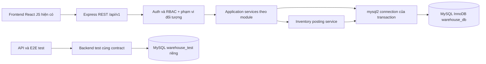

<!-- WAREHOUSE_PORTABLE_20261023 -->
## Docker warehouse hiện hành — 23/10/2026

Người dùng đã giao thêm SQL Server container và đổi project Docker thành **warehouse**. Compose mặc định tại root chạy SQL Server2022Developer riêng (SSMS: localhost,14330), db-init/migrate/Express/frontend; app http://localhost:8080, backend3001. Lần đầu chạy `node scripts/setup-docker.js` rồi `docker compose up -d --build`; những lần sau `docker compose up -d`. `scripts/start-docker.ps1` nay dùng bản portable, không phụ thuộc SQL Server Windows/dynamic port. [Hướng dẫn hiện hành](docker_warehouse.md).

Giữ nguyên HTTT02/Windows .env/data và các MySQL/Prisma archives. Chế độ Windows chuyển sang `infra/compose.windows.yaml`/`scripts/start-docker-windows.ps1` (project warehouse-windows); hướng dẫn cũ bên dưới về start-docker dò Windows port là lịch sử đã được thay thế cho chế độ mặc định. Không đồng bộ/copy dữ liệu giữa SQL Server Docker và HTTT02; cả hai có thể mở cùng SSMS. Volumes mới warehouse_sqlserver_data/warehouse_demo_artifacts/warehouse_uploads riêng; credentials riêng local ignored, backend không dùng sa. Seed fixture19accounts trong Docker, không import dữ liệu cũ; seed một lần, không overwrite. Schema76bảng/237FK/native checksum và 29UC giữ nguyên, DA_CODE_CHUA_TEST; chỉ kiểm cú pháp/config/bootstrap/migration/health, không unit/integration/E2E/regression. Không commit/reset/drop/delete volume. Nhóm warehouse-foundation cũ giữ ở trạng thái dừng, không tự xóa.

---

<!-- SQLSERVER_CURRENT_20261016 -->
> **Công nghệ hiện hành 16/10/2026:** Microsoft SQL Server 2022 trên `NGUYENTRONG-200\HTTT02`, Express/JavaScript CommonJS + `mssql`, migration T-SQL. Các hướng dẫn MySQL/mysql2/Prisma/InnoDB/utf8mb4 và lệnh Compose cũ phía dưới là **DA_THAY_THE về công nghệ**, giữ làm lịch sử; quyết định nghiệp vụ vẫn theo FS01–FS12 và các phê duyệt còn hiệu lực. Không chạy test tự động hoặc tự nghiệm thu UC. Xem [hướng dẫn hiện hành](sqlserver_runbook.md) và [báo cáo chuyển đổi](sqlserver_conversion.md).

## Kiến trúc SQL Server hiện hành

React → REST API giữ nguyên → router/controller → service → repository T-SQL → mssql ConnectionPool → SQL Server Windows. Một Modular Monolith, một database nghiệp vụ và một database test. Không ORM/TypeScript. Transaction dùng `mssql.Transaction`, một physical connection xuyên module, READ COMMITTED + XACT_ABORT; khóa nguồn/kho/actor theo thứ tự cũ bằng UPDLOCK/HOLDLOCK/ROWLOCK. Không tự retry posting khi lỗi. sp_getapplock khóa migration theo transaction.

Transport SELECT dùng FOR JSON PATH trên server và parser lossless để DECIMAL/BIGINT không qua JavaScript Number mất chính xác; JSON nghiệp vụ được parse riêng, datetime2 UTC giữ tương thích DTO. INSERT OUTPUT trả ID dạng varchar trong chính statement. Parameter binding không dịch SQL runtime. Error boundary ánh xạ mã SQL Server, không trả SQL/credential. Frontend/API/RBAC/29UC không đổi. Compose mới nối host.docker.internal; MySQL chỉ lưu nguồn cũ.

# Kiến trúc — thiết kế Giai đoạn 0 và nền tảng Giai đoạn 1

## Mã nguồn bàn giao ngày16/10/2026

Đã tạo code FE/BE/MySQL cho29UC, trạng thái **DA_CODE_CHUA_TEST**, chưa nghiệm thu. [Bàn giao và chạy local](full_system_handoff.md), [manifest module/API/bảng/file](full_system_manifest.md). Các mục UC01/nền tảng/“chỉ đề xuất” bên dưới là hồ sơ các giai đoạn trước.

Express CommonJS/mysql2 giữ MVC: router dùng operation OpenAPI → controller → service orchestration → repository SQL tham số. Modules thực tế dùng tên `qc`, `stocktake`, `reports` cho quality/stocktaking/reporting, thêm dispositions/evidence để tách trách nhiệm; không file module rỗng. Runtime OpenAPI sinh từ handler đã bind (151 business +3auth +health), không còn chỉ health/auth. React giữ layout/style, features ResourcePage/RecordSummary/StocktakePanel/DataPage dùng API, Home/Dashboard dùng dữ liệu thật theo quyền.

Business writes dùng một connection/transaction READ COMMITTED, khóa actor/quyền/scope rồi mutex kho/nguồn và hàng chi tiết; idempotency trả lại kết quả đã commit hoặc409 khi cùng key khác nội dung. SQL chỉ ở repository; maintenance dùng actor_kind SYSTEM. Tồn vật lý chỉ đổi trong posting/ledger; UC13 lưu phân bổ/snapshot sức chứa, UC15 chỉ giữ tồn. Planning forecast không là hold. Giữ khóa/generation/lease kiểm kê và nguồn QC nhiều đợt. Các bất biến đã code, chưa có bằng chứng kiểm chức năng/cạnh tranh.

Compose giữ volume MySQL cũ, bổ sung bind `backend/uploads` cho bằng chứng; `.dockerignore` loại uploads/credentials khỏi image. Prisma chỉ archive, không dependency runtime. Bảy migration đã áp dụng dev/test độc lập; không sửa checksum file đã apply. Build và readiness container đạt không chứng minh29UC đúng nghiệp vụ.

## Phạm vi thực hiện hiện hành — 15/10/2026

Đã giao cả29UC trong một nhiệm vụ; bỏ gate riêng UC01/nghiệm thu giữa các UC, hoãn chạy các bộ test theo lệnh mới. Kiến trúc mục tiêu giữ Express/JavaScript CommonJS/mysql2/MySQL8.4.8 Modular Monolith+MVC và frontend React/Vite/Tailwind. Dự kiến bổ sung modules customers/orders/production/purchasing/quality/warehouse/inventory/returns/stocktaking/reporting với nghiệp vụ thực, không file rỗng; auth/health đã có. [Kế hoạch liên tục](full_system_execution.md), [điểm chặn policy/contract](full_system_policy_approval.md). Đây là phạm vi được giao, không là báo cáo các module đã được code. Hiện chưa tạo code/module/migration mới trong nhiệm vụ15/10; các mục UC01/Giai đoạn0–1 bên dưới giữ làm lịch sử.

## Hiện thực UC01 — 14/10/2026

Giai đoạn 2 được giao chỉ UC01, hiện CHO_NGUOI_DUNG_XAC_NHAN. Auth routes/controller/service/repository và middleware authenticate đã có, dùng CommonJS/mysql2, không ORM/TypeScript. Service resolve MySQL session trước requirePermission/customer scope; không tin client principal. Auth SessionResult trả phẳng đúng contract (health vẫn data/meta). Login/rotation/counter và logout/audit/idempotency dùng transaction cùng connection, khóa account tăng dần → role → session → idempotency. Không tạo module UC khác hoặc bảng mới.

React bổ sung AuthProvider/login/protected routes, cookie HttpOnly, CSRF/principal chỉ memory, không browser storage; menu/cards/thông báo kho theo quyền, tên/vai trò thật, landing `/`. Màu/font/layout/CSS/mock data cũ giữ nguyên. UC khác vẫn mock/placeholder, không là API nghiệp vụ. runtime_api.json chỉ 2 health + 3 auth operations; foundation_api.json giữ cho regression. Docker pin và volumes giữ nguyên; ARGON2 costs đã duyệt và ngoại lệ cookie HTTP loopback rõ trong Compose. [Thiết kế](usecases/UC01.md), [evidence](usecases/UC01_review.md). Nội dung nền tảng chưa auth dưới đây là lịch sử.

Thiết kế ngày 11/10/2026, cập nhật hiện thực nền tảng ngày 12/10/2026 tại mục cuối. Khảo sát ban đầu dưới đây là lịch sử Giai đoạn 0. **Công nghệ đã xác nhận; policy nghiệp vụ CHUA_DUYET giữ mở**. Nguồn: README mục 3–9; SRS 2.3 toàn bộ (kế thừa2.2, đồng bộ xác nhận hiện hành); tám file docs/domain; mã nguồn frontend hiện có. Quyết định mở tại [decisions.md](decisions.md).

## Hiện trạng đã kiểm tra

- Root có README.md, docs/srs.md, tám Domain Model và frontend/. Chưa có backend/, infra/, root package.json, schema/migration hoặc test nghiệp vụ.
- frontend có src/, public/, package-lock.json, .env.example, .env, .oxlintrc.json; có node_modules/ và dist/ nhưng không sửa/đọc nội dung các thư mục sinh ra. Không có eslint.config.js như cây minh họa README.
- Git ban đầu: 11 đường dẫn tracked cũ bị xóa (srs.md, tám domain/*.md, hai DOCX); README/docs/frontend untracked. Đây là hiện trạng có sẵn; không kết luận đã migration/đổi tên, không restore hay commit.
- frontend/.gitignore bỏ qua node_modules/dist nhưng chưa bỏ qua .env; root chưa có .gitignore. Cần bổ sung bảo vệ khi dựng nền tảng, trước thao tác Git stage. Giai đoạn này không sửa frontend.
- API client chưa được dùng để lấy dữ liệu; home/dashboard dùng mock, 13 route placeholder. Chưa có UC hoàn thành.

## Cấu trúc mục tiêu (chỉ đề xuất, chưa tạo)

```text
Code/
  README.md, AGENTS.md, .gitignore, .env.example
  docs/
    srs.md, domain/                         # nguồn giữ nguyên
    architecture.md, frontend_audit.md, domain_consolidation.md
    database_design.md, business_rules.md, permissions.md
    api_contract.yaml, uc_dependencies.md, uc_progress.md
    testing_strategy.md, decisions.md, traceability.md, uc_catalog.md
    usecases/                              # chỉ tạo khi bắt đầu UC
  frontend/                                # giữ nguyên cấu trúc JS hiện có
    src/{components,pages,routes,data,services,utils,assets}
    tests/                                 # bổ sung khi được duyệt
  backend/                                 # Giai đoạn 1
    src/
      app.js, server.js
      config/{environment.js,database.js}
      modules/health/{routes.js,controller.js,service.js,repository.js}
      modules/{auth,catalog,orders,production,purchasing,quality,
               warehouse,inventory,returns,stocktaking,reporting}
      shared/{database,errors,validation,rbac,audit,idempotency,logging}
    database/{migrations,migrator.js,schema-verification.js,sql.js,migration-history.sql}
    tests/{unit,integration,fixtures}
    package.json, .env.example
  tests/e2e/                               # kịch bản giao diện liên UC
  infra/compose.yaml
  .github/workflows/ci.yaml                 # nếu duyệt CI
```

Node.js + Express + JavaScript CommonJS, Modular Monolith + MVC đã được người dùng xác nhận thay stack cũ; frontend tiếp tục JavaScript ESM. Không cần root workspace package manager ngay; ban đầu giữ script npm hiện có, orchestration root chỉ thêm khi có nhu cầu. Không tạo file rỗng.

## Ranh giới module

| Module | Trách nhiệm/UC | Chủ sở hữu dữ liệu |
|---|---|---|
| auth | UC01, session, RBAC | TaiKhoan, VaiTroQuyen, Quyen, phiên |
| catalog | UC10/19/20/25/30; lookup xưởng/NCC | NL, TP, đơn vị, quy cách, kho/vị trí/lô |
| orders | UC11, theo dõi giao qua UC12 | DonHang, ChiTietDonHang |
| production | UC02/03/22/24 | KHSX, chi tiết, định mức/nhu cầu, phiếu yêu cầu |
| purchasing | UC26/27 | PO và chi tiết, nhận giao hàng |
| quality | UC04/14/29 | QC header/detail và quyết định chất lượng |
| warehouse | UC12/13/15/16/17/21/23 | phiếu thực tế; điều phối dùng cùng dòng phiếu |
| inventory | ghi nhận dùng chung, không UC mới | TonKho, ledger, reservation, post/reversal |
| returns | UC18 và nguồn UC14/17 | yêu cầu trả, dòng trả, xử lý lỗi |
| stocktaking | UC07/08/09 | snapshot, phiên đếm, xác minh, đề nghị |
| reporting | UC05/06 | truy vấn read-only, cảnh báo cấu hình |

Module gọi application service công khai của module khác, không tự cập nhật bảng tồn. InventoryService nhận transaction client từ orchestration để chứng từ/QC quota/tồn/ledger/audit cùng commit. Một DB vật lý, FK xuyên module; không microservice/message broker để ghi tồn.



## Hợp đồng và vận hành dự kiến

- OpenAPI trước code, URI /api/v1; apiClient hiện base /api, sau duyệt dùng đường dẫn service /v1/... hoặc đổi env mẫu có kiểm soát. Không đổi cấu hình ở Giai đoạn 0.
- Đã xác nhận session opaque trong HttpOnly cookie, lưu hash token trong DB, CSRF cho thao tác ghi, CORS allowlist + credentials nếu khác origin; hết hạn/khóa tài khoản phải hủy quyền ngay. Chi tiết [permissions.md](permissions.md), D07.
- Request validation → auth → scope → service → transaction → response. Trả decimal/id dạng chuỗi; lỗi có code, fieldErrors, correlationId; không log mật khẩu/cookie/connection string.
- Deploy một backend JavaScript CommonJS, mysql2/promise 3.24.0. App credential chỉ DML; migration credential riêng. SQL có tham số trong repositories, không query SQL trong controllers. Uploads/secret files ngoài Git.
- Docker ComposeV2 đã xác nhận thiết kế, MySQL 8.4.8 LTS image pin version/digest, healthcheck, volume dev/test riêng, timezone UTC trong DB, frontend hiển thị Asia/Ho_Chi_Minh. Không mật khẩu mặc định trong repo.
- SQL migrations versioned/checksum/review; mở rộng trước, thu hẹp sau phê duyệt. _sql_migrations ghi trạng thái; _prisma_migrations giữ lịch sử. Không dùng shadow/reset trong quy trình mới; warehouse_shadow cũ được bảo tồn và không sử dụng.
- CI nếu duyệt: lint/build, validate OpenAPI, migration trên MySQL sạch, unit/API/E2E của UC đã hoàn thành. Test DB không kết nối môi trường thật.

## Cổng giai đoạn

Giai đoạn 0 kết thúc bằng hồ sơ này, không có backend/DB chạy. Giai đoạn 1 chỉ bắt đầu sau người dùng duyệt các quyết định chặn và ra lệnh; kiểm tra health/migration/seed an toàn. Giai đoạn 2 chỉ một UC được chỉ định, sau test dừng ở CHO_NGUOI_DUNG_XAC_NHAN.

## Orchestration và phục hồi sau xác nhận

warehouse sở hữu phiếu/allocation; inventory sở hữu balance/ledger/hold qua ReservationService/PostingService nhận cùng mysql2 connection của transaction. quality sở hữu inspected/accepted/consumed quota, production BOM/demand, orders delivery, returns reception/quarantine, stocktaking scope lease/generation/snapshot. Orchestrator gọi service công khai với transaction hiện tại, không nested transaction độc lập/tự cập nhật bảng module khác.

Confirm UC15 giữ stock và source quota atomic, không ledger vật lý. Posting kiểm QC/order/demand/scope/capacity rồi consume own hold và ghi document/balance/ledger/audit/idempotency một commit. UC13 capacity hold CHUA_DUYET; luôn revalidate capacity/QC lúc post. Mọi luồng kể cả expiry/cancel/cutoff dùng thứ tự khóa database_design, không network/chờ người dùng trong transaction.

Recovery worker trong monolith + lazy recovery tại inventory gate dùng version/job lease. Scope expiry vô hiệu proposal cũ trước unlock, fencing generation chặn retry cũ; không quyết định tồn bằng event eventual consistency. Report/cảnh báo đọc sau commit.

Compose MySQL/BE/FE chỉ sau lệnh Giai đoạn 1; FE giữ npm scripts, BE cho chạy trực tiếp dev. UTC lưu trữ, Asia/Ho_Chi_Minh nghiệp vụ. Auth cookie HttpOnly+CSRF đã xác nhận; idle 30 phút/hard 8 giờ, không refresh token;5 lần sai trong 15 phút khóa tạm 15 phút; password 12–128. Threshold IP/cấp-reset và policy nghiệp vụ còn CHUA_DUYET. Middleware: limits/correlation→auth (ngoại trừ login)→CSRF ghi cookie→validation→RBAC/scope→state/transaction→response. Không tự khởi tạo hạ tầng.

## Xác nhận nền tảng 12/10/2026

Node 24.21.0 LTS/Express 5.2.1/CommonJS, mysql2/promise 3.24.0, MySQL 8.4.8 InnoDB/utf8mb4. SQL migrations tăng dần, orchestration dùng một connection xuyên modules. Hai MySQL instances/volumes/credentials dev/test riêng, không reset dev.

Auth module sở hữu role/account/session, customer scope từ KhachHang1:N accounts. Internal customer_id NULL, không UNIQUE customer_id; role+object scope backend, phân biệt creator audit và customer ownership. AU01–03 đã xác nhận; kiểm hard expiry trước renew idle. Session/revocation kiểm quyền hiện hành, không kéo dài hard lifetime qua GET/me hoặc traffic.

VND amount20,0/quantity-price20,6/factor20,9, API chuỗi decimal; không intermediate rounding. Rule rounding tại xác nhận chứng từ chưa chốt mode/line-vs-total thì POLICY_NOT_APPROVED; không tự bậtHALF_UP. Capacity/hold/stocktake/delivery policies không tự được duyệt theo scaffold. Frontend và 29 UC giữ nguyên, chưa login UI hoặc code UC.

## Hiện thực nền tảng Giai đoạn 1 — 12/10/2026

Backend có app/server, config, shared helpers, auth primitives và health MVC routes/controller/service/repository. Database hiện có 8 bảng nền tảng; chưa tạo inventory/BOM/QC/stocktaking tables. Các bounded contexts còn lại chỉ mô tả, không controller/service rỗng.

GET /health và /api/v1/health kiểm MySQL thật. /docs và /api/v1/openapi.json chỉ phục vụ 2 operations trong foundation_api.json; contract 105 operations nghiệp vụ được giữ riêng. Có logging, error boundary, correlation ID, CORS, cookie parser, CSRF/RBAC primitives; chưa có login/session resolver hoặc CRUD UC.

Node 24.21.0, Express 5.2.1, mysql2/promise 3.24.0, Jest 30.5.2/Supertest. Không build/transpile backend; npm start chạy src/server.js. Lịch sử stack cũ được giữ trong phiếu phê duyệt và báo cáo Giai đoạn 1 trước đổi stack.

Compose: MySQL dev/test 8.4.8, instances/volumes riêng; profile app chứa migrate one-shot, backend và frontend. Backend chạy USER node, dùng secret files; frontend Nginx proxy /api và SPA fallback. Vite proxy và apiClient fallback /api là thay đổi cấu hình tối thiểu; giữ UI/mock/dependencies. Trạng thái CHO_NGUOI_DUNG_XAC_NHAN. [Hướng dẫn](phase1_runbook.md), [bằng chứng](phase1_review.md).

## MVC và transaction thực tế sau chuyển đổi

Routes khai báo URL/middleware; controllers nhận request/trả envelope; services điều phối và sở hữu transaction; repositories dùng execute(sql, params). Config sở hữu env/pool; shared có errors/logger/guard; auth primitives chưa có login/session resolver. Health repository thực sự kiểm SELECT 1 trên connection, không SQL trong controller. Các module business tương lai theo cùng MVC.

withConnection đặt UTC và release trong finally. withTransaction begin/commit/rollback trên một connection, không nested transaction độc lập hoặc tự retry khi kết quả commit không rõ. Orchestrator truyền chính connection này tới repositories liên quan; FOR UPDATE khóa các dòng theo thứ tự đã duyệt. Pool giữ DECIMAL/BIGINT dạng chuỗi, không tự làm tròn. Chưa thêm nghiệp vụ posting/reservation/QC.

## Xác minh runtime hiện hành — 14/10/2026

Container được kiểm thực: Node 24.21.0/Express 5.2.1/mysql2 3.24.0/type commonjs/UID 1000; không resolve được Prisma/TypeScript/tsx. Source API/migration không đọc backend/prisma; thư mục này chỉ archive có thể nằm trong image do COPY backend. _prisma_migrations vẫn là history SQL đọc qua mysql2, không là ORM dependency. [Evidence mới nhất](phase1_verification.md), [UC01 scope đề xuất](uc01_scope_proposal.md); không triển khai auth trong bước kiểm này.
