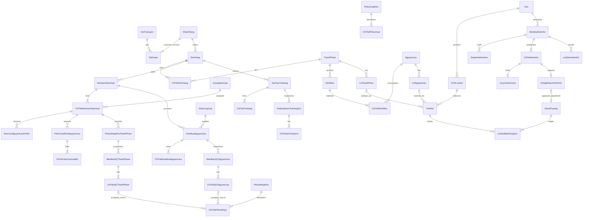

<!-- SQLSERVER_CURRENT_20261016 -->
Thiết kế bổ sung26/10 đã được người dùng duyệt: BaoGiaNguyenLieu lưu quan hệ NCC–vật tư–đơn vị, revision, đơn giá20,6 và hiệu lực UTC; UNIQUE theo NCC/vật tư/đơn vị/revision,3FK. DonMuaNguyenLieu thêm notes NVARCHAR(2000) NULL. Migration cộng thêm trên SQL Server Docker, không sửa migration cũ hoặc snapshot đơn mua. [Chi tiết](purchase_supplier_design.md).

> **Công nghệ hiện hành 16/10/2026:** Microsoft SQL Server 2022 trên `NGUYENTRONG-200\HTTT02`, Express/JavaScript CommonJS + `mssql`, migration T-SQL. Các hướng dẫn MySQL/mysql2/Prisma/InnoDB/utf8mb4 và lệnh Compose cũ phía dưới là **DA_THAY_THE về công nghệ**, giữ làm lịch sử; quyết định nghiệp vụ vẫn theo FS01–FS12 và các phê duyệt còn hiệu lực. Không chạy test tự động hoặc tự nghiệm thu UC. Xem [hướng dẫn hiện hành](sqlserver_runbook.md) và [báo cáo chuyển đổi](sqlserver_conversion.md).

## Thiết kế vật lý SQL Server đã triển khai

Nguồn thực thi: `backend/database/sqlserver/migrations/202610160001_native_schema.sql` (76 bảng nghiệp vụ, 237 FK, 87 index bổ sung; PK/CHECK/computed columns). Mô hình giữ nguyên các bảng đã code cho 29 UC; không thêm lớp nghiệp vụ. `_sql_migrations` là metadata kỹ thuật; `_warehouse_environment` chỉ có ở test. Bảng/quan hệ chi tiết tại [manifest SQL Server](sqlserver_schema_manifest.md).

| MySQL cũ (DA_THAY_THE) | SQL Server hiện hành |
|---|---|
| BIGINT UNSIGNED AUTO_INCREMENT | BIGINT IDENTITY(1,1), CHECK dương; API string |
| INT UNSIGNED | BIGINT + CHECK >=0 để giữ dải unsigned INT |
| VARCHAR/TEXT utf8mb4 | NVARCHAR(n)/NVARCHAR(MAX), Latin1_General_100_CI_AI_SC |
| utf8mb4_0900_bin trên mã/login/hash | Latin1_General_100_BIN2 |
| DATETIME(3), UTC_TIMESTAMP | DATETIME2(3), SYSUTCDATETIME; ngày DATE và múi giờ VN tại nghiệp vụ |
| ENUM/BOOLEAN/JSON | NVARCHAR + CHECK / BIT / NVARCHAR(MAX) + ISJSON |
| generated stored | computed PERSISTED, CASE/COALESCE |
| UNIQUE nullable | filtered unique index, lọc các khóa NULL |
| ON DELETE/UPDATE RESTRICT | NO ACTION, không cascade lịch sử |
| FOR UPDATE/FOR SHARE | UPDLOCK,HOLDLOCK,ROWLOCK / HOLDLOCK,ROWLOCK |
| GET_LOCK/DDL implicit commit | sp_getapplock + transaction DDL rollback thật |

VND/DECIMAL(20,0), lượng và giá(20,6), hệ số(20,9), capacity trung gian(35,15) giữ nguyên. KhachHang1:N TaiKhoan, customer_id nội bộ NULL, không UNIQUE. Reservation/ledger/QC nhiều đợt/rework/BOM/snapshot/đếm kiểm kê và trace chứng từ giữ FK/check/quota. Null unique của StockPosting, QC source line và ChiTietKiemKe đã chuyển có chủ đích. Không nhập dữ liệu MySQL tự động; ID signed BIGINT cần đối chiếu trước import. Chính sách FS01 làm tròn tại xác nhận vẫn giữ nguyên.

# Database MySQL thống nhất — thiết kế và migration nền tảng

## Hiện thực và migration — 16/10/2026

Bảy migration202610150001–0007 đã **APPLIED** trên warehouse_db và warehouse_test; hai bản nền tảng20261012 giữ **BASELINED_LEGACY**. Không còn pending sau đợt này. Các ghi “chưa apply” trong nhật ký trước16/10 là lịch sử; không sửa bảy file đã apply. [Bảng/ALTER theo từng version](full_system_manifest.md), [giới hạn và vận hành](full_system_handoff.md).

Schema hỗ trợ29UC: catalogs/units/scopes, price/packaging/BOM/calendar versions, orders/plans/demands/purchases/requests, QC nhiều đợt và nguồn rework XOR, receipt/issue generation/hold, DAT/QUARANTINE/FAILED/EXPIRED balances, ledger/StockPosting với FK duy nhất đến chứng từ, unknown intake, immutable snapshot/count/evidence, adjustment/disposition, alert revision và PhanBoTonDuKien. Quota liên dòng/FEFO/capacity/RBAC/lease được kiểm tại service trong transaction; CHECK không thay kiểm aggregate/concurrency.

PO HOAN_THANH nghĩa đã nhận đủ lượng giao, không khẳng định QC đạt/nhập đủ. Yêu cầu NL phản ánh lượng đã xuất; nguồn QC nhập phản ánh lượng thực ghi sổ. Chất lượng theo balance vì cùng lô có thể có phần đạt/lỗi/cách ly; ACTIVE/LOCKED của danh mục không thay QC. Báo cáo tồn theo kỳ tổng hợp ledger UTC theo ranh giới ngày Asia/Ho_Chi_Minh; không suy diễn reservation lịch sử.

## Bổ sung mã nguồn FS03 ngày 15/10/2026

`PhanBoTonDuKien(demand_id, warehouse_id, qty_assigned)` hỗ trợ phân bổ ước tính tồn cho nhu cầu KHSX, có FK thật đến nhu cầu/kho và UNIQUE theo cặp. Căn cứ FS03: hai kế hoạch không cùng dùng một phần free stock khi tính thiếu/mua. Bảng không giữ tồn và không thay on_hand/reserved/ledger; reservation bắt buộc vẫn thuộc UC15. Các warehouse gate khóa tăng dần trước plan/demand; tính phần dự kiến còn lại sau lượng đã xuất/đang giữ cho chính nhu cầu. Đây là bảng hỗ trợ quan hệ đã duyệt, không thêm UC hoặc lớp điều phối.

Giao dịch ghi nghiệp vụ đặt **READ COMMITTED cho transaction kế tiếp**, cùng khóa aggregate/gate/FOR UPDATE; không đổi isolation mặc định của pool, auth hoặc migration. Aggregate sau khi chờ khóa phải thấy commit mới; quota nguồn vẫn có mutex, không chỉ dựa vào isolation. Migration 202610150007 đã APPLIED ngày16/10 trên dev/test. Chưa kiểm thử concurrency hoặc nghiệp vụ SQL mới.

## Mã nguồn migration mới đang viết —15/10/2026

FS01–FS12 đã DA_XAC_NHAN. Có hai SQL files mới **chưa apply**: 202610150001_catalogs.sql (units, NL/TP, quy cách, giá bán versioned, kho/vị trí, scope, NCC/xưởng, lô và occupancy factors); 202610150002_orders_production.sql (orders/lines, BOM/calendar, KHSX/line/day-allocation/demands, PO/allocation, yêu cầu NL/TP). Tất cả additive CREATE, FK RESTRICT/CHECK/unique; không chỉnh hai migration lịch sử hoặc bảng đang có. Định nghĩa giá bán phục vụ FS02/UC25/11, không là UC mới. Các migration inventory/QC/return/stocktake và kiểm MySQL thực chưa hoàn tất; không coi blueprint là schema đã chạy. Chưa được chạy test/migration tự động theo từng UC.

## Lệnh triển khai toàn bộ — 15/10/2026

Người dùng đã giao hoàn thiện schema chung cho29UC, migration versioned theo phụ thuộc, giữ dữ liệu/volumes/history. Không còn giới hạn chỉ bảng UC01 theo quy trình cũ; vẫn không được tự chọn chính sách nghiệp vụ CHUA_DUYET hoặc tạo bảng thiếu căn cứ. [FS01–12](full_system_policy_approval.md) là phương án cần chốt trước phần schema phụ thuộc giá/hao hụt/hold/stocktake/delivery/intake/rework. Schema/contract chung phải được review tác động, không dùng db push/drop/reset để vượt bất tương thích. Trong lần tiếp nhận này **chưa tạo/apply migration, chưa truy vấn hoặc ghi database**, chưa xác minh runtime lại. Blueprint bên dưới chưa được coi là database đã tồn tại.

## Database phục vụ UC01 — 14/10/2026

Tái dùng đúng 8 bảng nền tảng, **không migration/schema mới**, giữ checksum/history SQL và archive Prisma. TaiKhoan.password_hash là Argon2id 65536 KiB/3/1; failed counter/window/locked_until cập nhật dưới khóa account, status LOCKED không tự đổi. PhienDangNhap chỉ token_hash/csrf_hash SHA-256, expiry idle/hard UTC, revocation; renew không kéo hard. Audit login/logout actor hợp lệ, không mật khẩu/token. Logout IdempotencyRequest cùng transaction với revoke/audit, expiry tại hard expiry phiên, không áp dụng TTL này cho business. Runtime SQL tự đặt updated_at, không ORM hook.

Seed demo được người dùng cho phép: 9 role SRS/10 accounts/1 KH giả, 2 account cùng customer_id, account nội bộ NULL; không UNIQUE customer_id. Không thêm kho/xưởng hoặc scope tables: SessionResult scopes=[] và deny mặc định. Tests HTTP commit fixtures chỉ warehouse_test đã guard, cleanup đúng IDs riêng theo FK; không reset/dev test writes. [UC01](usecases/UC01.md), [evidence](usecases/UC01_review.md). Blueprint nghiệp vụ 29 UC và policy CHUA_DUYET dưới đây giữ nguyên.

Ngày 11/10/2026; **Đã xác nhận phạm vi; policy CHUA_DUYET tại decisions.md**. Phần thiết kế nghiệp vụ dưới đây là blueprint, chưa migrate toàn bộ. Database và migration SQL nền tảng đã thực hiện ngày 12/10/2026; xem mục cuối và phase1_review.md. Một database nghiệp vụ `warehouse_db`, test riêng `warehouse_test`. Bảng khái niệm giữ tên 34 lớp SRS; bảng kỹ thuật bổ sung có căn cứ, không tạo bảng cho mỗi actor. Xem [domain_consolidation.md](domain_consolidation.md).

## Quy ước vật lý

- MySQL Server 8.4.8 LTS đã xác nhận ngoại lệ NT03 (đáp ứng8.0+); CHECK enforce từ8.0.16 để CHECK được thực thi, mọi bảng InnoDB/utf8mb4; chuỗi tiếng Việt dùng VARCHAR/TEXT utf8mb4 thay NVARCHAR của sơ đồ. Collation văn bản utf8mb4_0900_ai_ci; mã nghiệp vụ/login dùng chuẩn normalize thống nhất, mã kỹ thuật phân biệt rõ nếu cần collation binary. CHECK được enforce từ 8.0.16 theo [MySQL](https://dev.mysql.com/blog-archive/mysql-8-0-16-introducing-check-constraint/).
- PK tất cả bảng: `id BIGINT UNSIGNED AUTO_INCREMENT`, API serialize chuỗi; bảng nối PK ghép chỉ khi ghi rõ. Mã gốc `ma...` → `code VARCHAR(50) NOT NULL UNIQUE` trừ lô/vị trí có unique ghép được ghi riêng, mã dòng có thể `UNIQUE(parent_id,line_no)` thay mã toàn cục; giữ mã gốc trong DTO khi cần.
- FK cùng kiểu unsigned, mặc định NOT NULL; `?` trong danh sách dưới đây là nullable. `ON DELETE RESTRICT`, `ON UPDATE RESTRICT` cho lịch sử; không cascade xóa chứng từ. Các bảng session/link kỹ thuật có thể cascade khi chưa có lịch sử, cần migration review.
- `created_at, updated_at DATETIME(3)` UTC, `created_by_id, updated_by_id` FK TaiKhoan cho dữ liệu người dùng tạo; `version INT UNSIGNED` để chống ghi đè. Chứng từ thêm `posted_at`, `posted_by_id`, `coordinator_id?`, `coordinated_at?`, `allocation_version`, `reason`, `status`. Nguồn seed có account hệ thống được định danh, không nullable actor một cách tùy tiện.
- Lượng `DECIMAL(20,6)`, đơn giá `DECIMAL(20,6)`, thành tiền VND `DECIMAL(20,0)`, hệ số `DECIMAL(20,9)` (đã xác nhận NT06); dùng phép tính thập phân chính xác và chuỗi ở API; mysql2 giữ DECIMAL dạng chuỗi, không dùng Number; thư viện tính toán sẽ chốt khi UC liên quan được giao. Chai/lon/cái phải nguyên bằng validation và CHECK tương ứng của bảng/dòng theo unit snapshot; không dùng Number/Float để cộng tồn. Kiểu ngày NSX/HSD `DATE`, nullable HSD chỉ khi danh mục cho phép.
- Trạng thái enum theo từng nhóm trong business_rules, không một enum cho toàn bộ bảng. Snapshot và ledger bất biến sau ghi; danh mục dùng ACTIVE/LOCKED, không xóa cứng khi có tham chiếu.
- mysql2/promise pool qua DATABASE_URL hoặc secret file, ứng dụng không root. Native PK/FK/unique/CHECK/generated columns/collations/indexes khai báo SQL migration có version/checksum/review; không ORM/schema DSL. [mysql2 Promise API](https://sidorares.github.io/node-mysql2/docs/documentation/promise-wrapper).

## 34 lớp → bảng logic chung

Thuộc tính nguồn đầy đủ tại domain_consolidation; dưới đây là FK/cột bổ sung và quy tắc. `qty`, `accepted_qty`, `rejected_qty`, `unit_id` dùng quy ước decimal/đơn vị trên. Tiền/dữ liệu giao hàng lưu snapshot, không đọc hồi tố từ danh mục hiện tại.

| Bảng/lớp | FK và cột trọng tâm | Unique/check/index riêng |
|---|---|---|
| KhachHang | thông tin cá nhân/liên hệ, status | code UQ; index phone/email, không mặc định email KH unique |
| TaiKhoan | role_id→VaiTroQuyen, customer_id?→KhachHang, password_hash Argon2id VARCHAR(255), login, admin status, failed_attempt_count, failed_window_started_at?, locked_until? | login UQ; customer_id index thường, không UNIQUE; một KhachHang có nhiều TaiKhoan |
| VaiTroQuyen | name, description, status; danhSachQuyen qua link chuẩn hóa | code UQ; không kiểm quyền bằng text danh sách |
| DonHang | customer_id, creator_id, ngày/địa chỉ/người nhận, delivery_status, status | index(customer_id,created_at), (status,due_date) |
| ChiTietDonHang | order_id, product_id→ThanhPham, packaging_id, unit_id, qty_input, factor_snapshot, qty_base, price, amount | UQ(order_id,line_no); qty>0, price>=0; index product_id |
| KeHoachSanXuat | order_id, creator_id, approver_id?, dates, rejection_reason, status | start<=end; index(order_id,status), (status,start_date) |
| ChiTietKeHoachSanXuat | plan_id, order_line_id, workshop_id, product_id, bom_version_id, qty_base, dates | UQ(plan_id,line_no); qty>0, start<=end; product trùng order_line kiểm transaction |
| XuongSanXuat | name/location, capacity, capacity_unit_id?, status | capacity>=0; capacity calendar theo D11 |
| DonMuaNguyenLieu | supplier_id→NhaCungCap, plan_id (Domain một KHSX), creator_id, approver_id?, currency, total_amount, status | index(supplier_id,status), (plan_id,status); không tổng kg+lít |
| ChiTietDonMuaNguyenLieu | purchase_id, material_id, unit_id, qty_base, qty_input, factor_snapshot, price, amount | UQ(purchase_id,line_no), qty>0, price>=0 |
| NhaCungCap | liên hệ/địa chỉ, status | code UQ; từ SRS, chưa có trong tám view |
| NguyenLieu | base_unit_id→DonViTinh, requires_expiry, packaging text mô tả, storage_condition, status | code UQ; unit cơ sở không sửa khi đã phát sinh |
| LoNguyenLieu | material_id, supplier_id?, NSX/HSD, received_at, QC status; quantities là projection | UQ(material_id,code); HSD>=NSX khi có; index(material_id,status,expiry_date,first_received_at) |
| ThanhPham | base_unit_id, container_type PET/GLASS/CAN, volume_ml, default_shelf_days, status | code UQ; volume>0; base unit đúng chai/lon; quy cách numeric versioned |
| LoThanhPham | product_id, production_request_id?, packaging_id, NSX/HSD, QC status | UQ(product_id,code); HSD>=NSX; index(product_id,status,expiry_date,first_received_at) |
| Kho | type MATERIAL/FINISHED/CONTROLLED, capacity, capacity_unit_id, status | code UQ, capacity>=0 |
| ViTriLuuKho | warehouse_id, area text, capacity/capacity_unit_id, storage_rule, status | UQ(warehouse_id,code), UQ(id,warehouse_id); remaining capacity là projection |
| TonKho | location_id, material_lot_id? hoặc product_lot_id?, quality_bucket, qty_on_hand, qty_reserved, version | XOR lô, qty>=0, 0<=reserved<=on_hand; khóa unique normalized bên dưới |
| PhieuNhapKho | warehouse_id, kind MATERIAL/FINISHED/RETURN/QUARANTINE, status, coordinator/audit, source loại | index(status,created_at), warehouse FK; D05 cho loại quarantine |
| ChiTietPhieuNhap | receipt_id, warehouse_id, location_id, một FK lô, unit/packaging snapshot, qty_base, quality_bucket, qc_material_line_id?/qc_product_line_id?/return_qc_line_id? | UQ(receipt_id,line_no), XOR lô và XOR nguồn QC cho nhập đạt; composite FK đảm bảo vị trí thuộc kho phiếu |
| PhieuXuatKho | warehouse_id, kind SALE/MATERIAL/DISPOSAL/SUPPLIER_RETURN, source_order_id?/material_request_id?/disposition_id?, status | XOR nguồn theo loại, index(status,created_at); disposal D05 |
| ChiTietPhieuXuat | issue_id, warehouse_id, location_id, một FK lô, source_order_line_id?/material_request_line_id?, qty_base, quality_bucket, unit snapshot | UQ(issue_id,line_no), XOR lô, qty>0; composite warehouse consistency |
| PhieuXuatKhoNguyenLieu | plan_line_id, workshop_id, creator_id, status | index(plan_line_id,status); lượng tổng theo đơn vị, thêm chi tiết yêu cầu |
| PhieuNhapKhoThanhPham | plan_line_id, workshop_id, creator_id, completed_qty, status | qty>0; gắn nhiều lô/dòng hoàn thành |
| BienBanQCNguyenLieu | purchase_id, delivery_id, inspector_id, inspected_at, status | index(purchase_id,status), quantities tổng chỉ cùng unit; chi tiết từng lô |
| BienBanQCThanhPham | production_request_id, inspector_id, inspected_at, status | index(production_request_id,status); không unique request để cho QC nhiều đợt (D10) |
| YeuCauTraHang | order_id, customer_id, creator_id, reason, status | index(order_id,status); chi tiết theo dòng giao/lô |
| KetQuaKiemTraHangTra | return_request_id, inspector_id, seal/label/package result, status | index(return_request_id,status); nhiều đợt qua detail (D10) |
| XuLyHangLoiTraVe | qc_material_line_id?/qc_product_line_id?/return_qc_line_id?, warehouse/location/lot nếu đã nhập vật lý, method, qty, proposer_id, approver_id?, status | XOR nguồn, qty>0; unique mã; không xử lý quá lượng lỗi còn lại |
| BienBanKiemKe | warehouse_id, cutoff_at, status, ledger_checkpoint, creator_id, confirmed_by? | index(warehouse_id,status,cutoff_at); phạm vi/count ở bảng kỹ thuật |
| ChiTietKiemKe | stocktake_id, snapshot_id?, location_id, một FK lô?, quality_bucket, qty_system, qty_counted, delta | stocktake/key UQ; snapshot nullable để đếm thừa mới thấy; unknown lot chưa điều chỉnh vào tồn chính |
| XuLyChenhLech | stocktake_line_id, verifier_id, reason, evidence_id?, status | UQ(stocktake_line_id) nếu một hồ sơ xác minh; revisions qua audit; có thể tạo trước đề nghị |
| DeNghiDieuChinhTon | stocktake_line_id, verification_id, qty_signed, proposer_id, approver_id?, approval_at?, status | UQ(stocktake_line_id) đề nghị hiệu lực; revision thay vì đề nghị song song; qty!=0 |
| CanhBaoKho | warehouse_id, lot/location?, rule_type, rule_version, severity, opened_at, resolved_at?, status | dedup_key UQ chống cảnh báo trùng; index(warehouse_id,status,severity) |

## Bảng bổ sung có căn cứ (không lớp điều phối)

Mỗi bảng có PK/FK/audit theo quy ước, ngoại lệ bất biến chỉ created_at/actor. BOM/QC/quy cách đã xác nhận phạm vi; policy/kiểu vật lý CHUA_DUYET cần chốt trước migration liên quan.

| Bảng kỹ thuật | Cột/FK | Ràng buộc và căn cứ |
|---|---|---|
| Quyen, VaiTro_Quyen | permission.code UQ; link role_id/permission_id PK ghép | NFR06, tách danhSachQuyen text |
| PhienDangNhap | account_id, token_hash UQ, created_at, last_seen_at, idle_expires_at, absolute_expires_at, revoked_at, csrf_hash | NFR05; index(account_id,idle_expires_at,absolute_expires_at) |
| TaiKhoan_Kho, TaiKhoan_Xuong | PK ghép account_id+scope_id FK | phạm vi đối tượng nhiều kho/xưởng |
| DonViTinh | code UQ, dimension, discrete, scale | RULE14/15; scale 0..6 |
| QuyCachDongGoi | product_id, revision, valid_from/to, base_unit_id, units_per_pack, capacity_factor | UQ(product_id,revision), factors>0, không sửa đã dùng |
| QuyDoiNguyenLieu | material_id, from_unit_id, revision, factor_to_base | UQ(material_id,from_unit_id,revision), factor>0; không tự đổi kg↔lít thiếu density |
| DinhMuc, ChiTietDinhMuc | product_id, revision, output_qty_base; child bom_id, material_id, qty_per_output | UQ(product_id,revision), UQ(bom_id,material_id), qty>0; D01 |
| NhuCauNguyenLieuKHSX | plan_line_id, material_id, bom_revision, qty_required, snapshot_available, shortage | UQ(plan_line_id,material_id), bom_line_id FK, quantities>=0; snapshot không thay tồn |
| PhanBoMuaChoNhuCau | demand_id, purchase_line_id, qty_base | UQ(demand_id,purchase_line_id), qty>0; tổng allocated không vượt demand/PO bằng khóa service |
| LichNangLucXuong | workshop_id, product_id, date/shift, capacity_base | UQ(workshop_id,product_id,date,shift), capacity>=0; D11 |
| ChiTietYeuCauXuatNL | material_request_id, material_id, demand_id, qty_base | UQ(request_id,line_no), qty>0; không vượt nhu cầu còn chưa cấp |
| ChiTietYeuCauNhapTP | production_request_id, product_lot_id, plan_line_id, qty_completed | UQ(request_id,line_no), qty>0; liên kết lô hoàn thành |
| DotGiaoNguyenLieu, ChiTietGiaoNL | delivery.purchase_id; line.delivery_id, purchase_line_id, material_lot_id, qty_received | UQ(delivery_id,line_no), qty>0; nhiều lần NCC giao |
| ChiTietQCNguyenLieu | qc_id, delivery_line_id, batch_seq, material_lot_id, inspected/accepted/rejected/received_good_qty | UQ(delivery_line_id,batch_seq) cho mỗi phần lượng kiểm; total=accepted+rejected; quota tiêu thụ khóa trên dòng |
| ChiTietQCThanhPham | qc_id, production_request_line_id, batch_seq, product_lot_id, inspected/accepted/rejected/received_good_qty | UQ(production_request_line_id,batch_seq); nhiều batch cho cùng dòng nguồn, tổng kiểm<=completed |
| ChiTietTraHang | return_request_id, original_delivery_line_id→ChiTietGiaoHang, original_issue_line_id→ChiTietPhieuXuat, reported_lot_code, qty_requested, qty_received | qty>=0, gắn dòng giao; null source chỉ khi chưa xác minh, không restock |
| ChiTietQCHangTra | return_qc_id, return_reception_line_id, batch_seq, product_lot_id?, inspected/accepted/rejected, restock_permitted, restocked_qty | UQ(return_reception_line_id,batch_seq); tổng kiểm<=received, accepted+rejected=inspected; restocked<=permitted |
| TiepNhanChuaDinhDanh | return_line_id?/delivery_line_id?, location_id, qty/unit, reported_code, condition, resolved_at | chưa định danh không tạo lô giả/TonKho; vẫn tính chiếm chỗ, liên kết chứng từ khi xác minh |
| StockPosting | receipt_id?/issue_id?/adjustment_id?, reversal_of_id?→StockPosting, posted_by_id, posted_at | XOR ba nguồn receipt/issue/adjustment, mỗi FK nguồn UQ; reversal_of chỉ tham chiếu posting gốc, reversal có chứng từ đảo được duyệt, không DELETE posting |
| LichSuBienDongTon | posting_id, line_seq, location_id, một FK lô, quality_bucket, signed_delta, stock_id, actor, at | UQ(posting_id,line_seq), delta!=0, XOR lô; index(lot,location,at,id); append-only |
| DatGiuTon (bắt buộc UC15) | stock_id, issue_line_id, demand_id?, allocation_version, qty_initial/consumed/released, expires_at, status | UQ(issue_line_id,stock_id,allocation_version), quantities>=0, consumed+released<=initial; thay reserved atomic, không stock ledger; index(status,expires_at) |
| SnapshotKiemKe | stocktake_id, location_id, một FK lô, quality_bucket, qty_snapshot, stock_version | UQ(stocktake_id,normalized_key), bất biến; không tạo row zero vô nghĩa, kiểm vị trí trống riêng |
| PhamViKiemKe | stocktake_id, location_id, confirmed_empty, assigned_counter_id | UQ(stocktake_id,location_id); cấp quyền đếm/phạm vi |
| KhoaViTriKiemKe | location_id UQ/PK, stocktake_id, locked_at, expires_at, heartbeat_at, owner_id, generation | chỉ tồn tại khi active; chặn overlap toàn vị trí, không partial unique index MySQL |
| LanDemKiemKe, ChiTietLanDem | stocktake_id, sequence, counter_id, submitted_at; child location/lot/bucket, counts pallet/carton/pack/loose, factors_snapshot, base_qty, condition, evidence | UQ(stocktake_id,sequence), UQ(count_id,key,condition); submitted immutable; đếm lần 2 độc lập |
| BangChung | checksum, storage_key, uploader_id, document FK cụ thể | file ngoài Git/DB blob; chỉ upload an toàn và scope quyền; retention cần duyệt |
| AuditLog | actor_id, action, target_type/id, before/after JSON, correlation_id, at | index(target_type,target_id,at), append-only; không secrets trong JSON |
| IdempotencyRequest | account_id, operation, key, request_hash, response JSON/status, posting_id?, expires_at | UQ(account_id,operation,key), key<=128, hash không chứa secret |
| CauHinhNghiepVu | code, scope, revision, value JSON, effective_at | UQ(code,scope,revision), xác thực kiểu và audit; NFR11 |

## Ràng buộc tồn và nguồn không nhập nhằng

TonKho và dòng phiếu/ledger chỉ có **đúng một** trong material_lot_id/product_lot_id (`(nl IS NULL) <> (tp IS NULL)`). Không dùng unique(location,nl,tp,bucket) trực tiếp: MySQL cho nhiều NULL trong UNIQUE. Đề xuất generated stored `lot_kind`=NL/TP và `lot_key`=COALESCE(nl,tp) rồi UQ(location_id,lot_kind,lot_key,quality_bucket), giữ cả FK thật. Generated stored columns được khai báo bằng SQL MySQL và kiểm metadata/constraints thật; phương án thay thế tách 2 bảng balance là quyết định cần duyệt, không tự đổi.

Composite FK `(location_id,warehouse_id)` → ViTri `(id,warehouse_id)` và `(receipt_id,warehouse_id)` → PhieuNhap `(id,warehouse_id)` đảm bảo dòng thuộc kho header; tương tự xuất. QC line phải trùng lô/mặt hàng nguồn, plan_line phải trùng sản phẩm order_line; dùng FK ghép nếu phù hợp, nếu chưa thể thì transaction service kiểm và test dữ liệu sai quan hệ. Lô NL không xuất SALE, TP không dùng request NL.

Các CHECK trên một dòng: qty>=0; accepted+rejected=inspected; accepted_input không vượt received của chính dòng nếu lưu snapshot; reserved<=on_hand; đúng XOR. Các tổng liên bảng (đã nhập<=QC, đã xuất<=đơn/yêu cầu, tổng sức chứa, tổng reservation, capacity xưởng) **không dùng CHECK liên bảng**, phải lock dòng nguồn/aggregate rồi kiểm transaction.

soLuongConLai lô = SUM(balance qua mọi vị trí/bucket); khả dụng chỉ bucket DAT, lô không hold/hết hạn, vị trí không khóa, trừ reservation một lần. Không duy trì cột khả dụng độc lập theo form. Sức chứa còn lại = capacity − lượng chiếm chỗ quy về cùng capacity_unit, kể cả cách ly/chưa định danh. Không cộng tổng qty của đơn vị khác nhau.

## Transaction và cạnh tranh

| Thao tác | Khóa/ghi nguyên tử | Hậu điều kiện |
|---|---|---|
| UC13/15 save/confirm | khóa phiếu/version + nguồn khi xác nhận; ghi detail/state/coordinator/audit | on_hand/lô projection/StockPosting/ledger không đổi; UC15 confirm tăng reserved qua hold atomic; UC13 giữ capacity CHUA_DUYET |
| UC03 approve | khóa KHSX và nhu cầu/định mức snapshot; capacity/demand allocation nếu duyệt | duyệt+nhu cầu+audit cùng commit, không cấp phát tồn |
| UC27 approve | PO version/state, approver audit | không stock |
| UC04/14/29 QC | nguồn qty nhận + kết luận QC/version | quota không âm, sum đúng, không nhập tồn đạt |
| UC16/21 post | phiếu, QC lines, positions capacity, lots, balances theo thứ tự ổn định | document+QC consumed+balance+posting+ledger+audit+idempotency response commit cùng nhau |
| UC12/23 post | phiếu, order/request lines, lots, positions, balances/reservations | không xuất âm/overfulfill, FEFO hợp lệ, đủ toàn bộ mới commit |
| UC17 restock | QC return quota + quarantine source + destination | trừ quarantine và cộng DAT cùng posting, tổng vật lý không tăng nếu đã nhận trước |
| UC18 disposition | phương án đã duyệt + lỗi quota + balances + chứng từ xử lý | trả NCC/tiêu hủy giảm vật lý; chuyển vị trí/trạng thái có hai leg delta, không mất lịch sử |
| UC07 cut-off | khóa hàng ViTri theo thứ tự id, tạo active scope locks, snapshot toàn phạm vi | commit cut-off+snapshot+scope atomically; cạnh tranh posting cùng location phải cùng lock protocol |
| UC08 verify | snapshot/count submitted + evidence + đề nghị | không ghi tồn |
| UC09 approve | đề nghị, stocktake scope, balances và posting key | approve+delta+ledger+audit một lần; mở khóa theo chính sách sau hoàn tất |
| hủy/reversal | chứng từ posted bất biến; chứng từ đảo được duyệt khóa nguồn, kiểm downstream quota/tồn | không đảo nếu phá dữ liệu đã cấp/giao/trả; giữ link và ledger cũ |

Mỗi posting dùng mysql2 connection với beginTransaction/commit/rollback; đề xuất ReadCommitted và locking reads có tham số (không nối chuỗi SQL đầu vào) cho vị trí/dòng nguồn/balance. Thứ tự chuẩn mọi module: location ids tăng dần → source/demand quota theo type/id → lot ids → balance ids → document ids → hold ids; stocktaking/recovery cùng location gate. Không giữ transaction khi gọi mạng/chờ người dùng. `SELECT ... FOR UPDATE` giữ khóa trong transaction theo [MySQL locking reads](https://dev.mysql.com/doc/refman/8.0/en/innodb-locking-reads.html).

Tạo balance chưa tồn tại phải dưới location lock và unique key; không chỉ lock row không tồn tại. Không dùng SKIP LOCKED rồi giả đủ lượng. Compare-and-swap phiếu `WHERE status=CHO_NHAP_XUAT AND version=expected`; update affected_rows=1 hoặc rollback. Idempotency UQ tạo trong transaction: request trùng key+hash trả kết quả cũ sau commit; trùng key khác payload=409. Post hai key khác nhau cùng phiếu bị UQ source và state chặn. Retry toàn transaction có giới hạn với deadlock/write conflict, không retry business validation và không tạo side effect ngoài transaction; mất response sau commit vẫn có lookup kết quả.

## ERD tổng quan

ERD tập trung chuỗi chứng từ; bảng kỹ thuật phụ và FK đầy đủ ở hai bảng trên. Bội số QC/nhập từng phần1:N đã xác nhận ở logic, nguồn khái niệm giữ nguyên.

## Migration/kiểm chứng dự kiến

SQL migration versioned/review/checksum, thứ tự theo filename; kiểm INFORMATION_SCHEMA cho PK/FK/UQ/CHECK/engine/collation. DDL MySQL có implicit commit, runner lưu APPLYING trước DDL và dừng khi lỗi, không giả rollback schema; forward fix/restore chỉ sau duyệt. Test guard trước mọi ghi, migration credentials riêng, không db push/reset/drop.

## Logic chi tiết sau xác nhận (không sửa 34 lớp khái niệm)

Bảng bổ sung phục vụ lớp nguồn, không lớp điều phối và không nhân bảng theo actor. PK/FK BIGINT UNSIGNED, engine/charset/audit theo đầu tài liệu; FK lịch sử RESTRICT. Precision/PK/collation đã xác nhận NT04–06; quy tắc làm tròn chốt chứng từ và các policy nghiệp vụ còn CHUA_DUYET.

| Bảng/cột | PK/FK/unique/check/index | Lý do và trạng thái |
|---|---|---|
| DinhMuc/ChiTietDinhMuc | FK product/material; UQ(product_id,revision), UQ(bom_id,material_id); output_qty/input_qty>0; valid_from<valid_to nếu có; index(product_id,valid_from,valid_to) | M:N tiêu hao vật tư version/effectivity đã xác nhận; khóa SKU kiểm chồng hiệu lực, không CHECK liên bảng; không công thức bí mật |
| ChiTietKHSX/NhuCauNL | bom_version_id NOT NULL→DinhMuc; demand FK bom_line_id, plan_line_id; UQ(plan_line_id,bom_line_id); qty_required>=0; snapshot BOM/unit | đúng SKU/hiệu lực khi lập, phiên bản đã dùng bất biến; tính lại thiếu khi duyệt nhưng không đổi BOM hồi tố |
| ChiTietQCNL/TP/Tra | source_line_id FK thật theo loại; batch_seq; UQ(source_line_id,batch_seq), UQ(qc_id,line_no); inspected>0, accepted/rejected>=0, sum=inspected, received_good<=accepted; index(source_line_id,status) | nhiều batch cho cùng source; chốt khóa source aggregate inspected<=received/completed, không hai kết luận cùng phần lượng |
| ChiTietQCHangTra | return_reception_line_id→ChiTietTiepNhanTra, product_lot_id; inspected/accepted/rejected/restock_permitted/restocked | permitted<=accepted, restocked<=permitted; lot xác minh và QC chốt trước UC17 |
| QuyCachDongGoi | product_id, revision, valid_from/to, base_unit_id, units_per_pack/carton/pallet; UQ(product_id,revision), factors>0 | số rời nguyên; numeric từng SKU/version, chứng từ/count FK và factor snapshot |
| HeSoChiemCho | material_id? XOR product_id?, packaging_version_id?, capacity_unit_id→DonViTinh, revision, factor_per_base, valid_from/to; normalized item key UQ(item_kind,item_id,capacity_unit_id,revision); factor>0 | riêng capacity dimension/unit; không dùng volume đồ uống làm chiếm chỗ kho; factor thực tế/thuật toán làm tròn CHUA_DUYET |
| DatGiuTon | stock_id→TonKho, issue_line_id→ChiTietPhieuXuat, demand_id?→NhuCauNL; allocation_version; initial/consumed/released, expiry/status/version; UQ(issue_line_id,stock_id,allocation_version); index(stock_id,status), (status,expires_at) | UC15 bắt buộc; reserved cache=SUM(active remaining) duy trì atomic; hold không stock ledger |
| DatGiuSucChua | receipt_line_id→ChiTietPhieuNhap, location_id, factor_version_id→HeSoChiemCho, capacity_initial/consumed/released, expiry/status; UQ(receipt_line_id,allocation_version), index(location_id,status,expires_at) | toàn bộ bảng/policy CHUA_DUYET: UC13 mới đề xuất capacity hold; không migrate khi chưa duyệt |
| DotGiaoHang/ChiTietGiaoHang | header order_id→DonHang; child delivery_id, issue_line_id→ChiTietPhieuXuat, dispatched/delivered qty, status, delivered_at/by; UQ(delivery_id,line_no), UQ(delivery_id,issue_line_id); 0<=delivered<=dispatched | phân biệt xuất/đang giao/đã giao; khóa dòng xuất để tổng dispatched<=posted; actor xác nhận giao CHUA_DUYET |
| ChiTietTraHang | original_delivery_line_id→ChiTietGiaoHang, original_issue_line_id, order_line_id, product_lot_id; requested/received; UQ(return_id,line_no) | cùng đơn/SKU/lô qua FK ghép hoặc service; khóa delivery quota SUM(return_received)<=delivered−returned, trừ ngoại lệ duyệt CHUA_DUYET |
| TiepNhanTra/ChiTietTiepNhanTra | header return_request_id, quarantine_receipt_id→PhieuNhapKho UQ; child return_line_id, receipt_line_id→ChiTietPhieuNhap UQ, location/lot?, qty_received, unit/factor snapshot | vật lý quarantine trước QC; một dòng trả nhiều reception, QC theo reception; unknown lot dùng TiepNhanChuaDinhDanh không khả dụng; actor/policy CHUA_DUYET |
| KhoaViTriKiemKe | PK location_id, FK stocktake_id; expires_at NOT NULL>locked_at, generation, owner/heartbeat; index(stocktake_id), (expires_at) | lease hữu hạn/fencing; generation vị trí tăng đơn điệu giữ tại ViTriLuuKho, không reset khi xóa active lock |
| BienBanKiemKe/DeNghiDieuChinh | scope_generation, interrupted_at/reason, terminal_at; proposal snapshot_id/stocktake_generation; index(status,cutoff_at) | UC09 kiểm lease/generation/scope active; mở scope do gián đoạn đánh VO_HIEU proposal chưa post |

### QC và nhu cầu

Yêu cầu/giao/reception1:N batch QC; batch1:N dòng; dòng QC1:N receipt lines. Draft không tạo quota; confirm khóa source và cộng inspected đúng một lần, tổng inspected<=source quantity. Reinspection/revision đã chốt CHUA_DUYET; không tự sửa accepted sau nhập. received_good quota=accepted−SUM(posted receipts), khóa QC line khi post. Trace receipt→QC batch line→source→plan/PO/return→lot; không chỉ source_id đa hình không FK.

N=requirement sản lượng×BOM; I=net đã cấp đúng demand; H=hold hiệu lực riêng demand; remaining=max(0,N−I−H). Free DAT trừ TẤT CẢ active holds một lần. Thiếu=max(0,remaining−free đã phân riêng demand). Không phân cùng free nhiều nhu cầu; snapshot dự kiến không bảo đảm như hold. PO chưa nhận không tồn; trừ PO trong nhu cầu mua/làm tròn/hao hụt CHUA_DUYET.

### Capacity và khóa

occupied=SUM(on_hand_base×factor_snapshot)+occupied_unidentified, gồm mọi bucket. capacity dimension/unit riêng; factor bất biến sau dùng. Nếu có giới hạn chung kho và vị trí: khóa gate kho trước location theo id cho tất cả capacity/stocktake/expiry operations, kiểm cả hai tổng. Capacity remaining trừ active capacity hold chỉ khi policy được duyệt. Move cùng vị trí/bucket transfer không cộng occupied lần hai. Unknown→identified giảm sổ unidentified và tăng balance cùng transaction; không double count. Pallet lẻ/cách xếp/làm tròn CHUA_DUYET.

Confirm UC15 khóa location/source/stock, kiểm source còn cần trừ hold phiếu khác, DAT/HSD/scope; insert hold+tăng reserved+CHO_NHAP_XUAT+audit/idempotency atomic. Post own remaining>=qty, đúng lô/vị trí/revision, chưa expired; giảm on_hand và reserved cùng qty, tăng consumed, fulfill source, StockPosting UQ nguồn, ledger−qty/audit/result một commit. Ví dụ100 hold70→onhand100/reserved70/free30; post70→onhand30/reserved0/free30. Không trừ tồn hai lần. Reopen/cancel/release unposted giảm reserved/tăng released, phiếu mất điều kiện post; consumed bất biến.

Expiry worker và lazy cleanup dùng cùng locks/version/time UTC của DB, trả remaining reserved và vô hiệu allocation atomic. Không loại expired khỏi query rồi để cached reserved sai. TTL/renew/priority CHUA_DUYET; thiếu cấu hình không confirm hold. Partial nguồn dùng nhiều phiếu riêng, chia lại phần chưa xong CHUA_DUYET; không sửa phiếu posted.

### Mở khóa kiểm kê an toàn

Cut-off location gate tạo snapshot/scope/lease/generation atomic. Renew có max bound hữu hạn, quyền/tham số CHUA_DUYET. Hoàn tất chỉ unlock khi count/verify/adjustment đã giải quyết; HUY/GIAN_DOAN/expiry vô hiệu mọi proposal chưa post trước xóa scope trong cùng transaction. UC09 kiểm generation/lease active, không dùng snapshot cũ sau mở khóa. Recovery worker scan expiry và inventory lazy cleanup dưới gate bảo đảm mở khi worker chết; restart không tự duyệt. Muốn tiếp tục tạo đợt/cut-off mới, giữ lịch sử count/snapshot/ledger. Freeze vs cuốn chiếu/TTL hữu hạn cần duyệt trước dựng lock.

~~~mermaid
erDiagram
  DinhMuc ||--|{ ChiTietDinhMuc : inputs
  DinhMuc ||--o{ ChiTietKeHoachSanXuat : applied_version
  NhuCauNguyenLieuKHSX ||--o{ DatGiuTon : demand
  ChiTietPhieuXuat ||--o{ DatGiuTon : allocation
  TonKho ||--o{ DatGiuTon : holds
  ChiTietYeuCauNhapTP ||--o{ ChiTietQCThanhPham : batches
  ChiTietQCThanhPham ||--o{ ChiTietPhieuNhap : partial_receipts
  ThanhPham ||--o{ QuyCachDongGoi : versions
  DonHang ||--o{ DotGiaoHang : deliveries
  DotGiaoHang ||--|{ ChiTietGiaoHang : lines
  ChiTietPhieuXuat ||--o{ ChiTietGiaoHang : source
  ChiTietGiaoHang ||--o{ ChiTietTraHang : returns
  ChiTietTraHang ||--o{ ChiTietTiepNhanTra : receptions
  ChiTietTiepNhanTra ||--o{ ChiTietQCHangTra : batches
  ChiTietQCHangTra ||--o{ ChiTietPhieuNhap : restock
  BienBanKiemKe ||--o{ KhoaViTriKiemKe : bounded_scope
  BienBanKiemKe ||--o{ SnapshotKiemKe : cutoff
~~~

Ghi nhận lịch sử Giai đoạn 0: khi đó chưa dựng DB hoặc kiểm metadata. Schema nền tảng hiện đã kiểm trên MySQL; blueprint nghiệp vụ/ERD không thay Domain nguồn.

### Hold khi chất lượng/kiểm kê thay đổi

Lot mất điều kiện/QC/HSD hoặc scope kiểm kê khóa: hold không làm hàng trở thành eligible, posting phải chặn. Release/expiry luôn giữ nguồn audit. UC09 delta giảm phải kiểm reserved<=on_hand sau điều chỉnh; nếu conflict trả409, rollback approval/posting, không tự cắt ưu tiên hold. Đề xuất vô hiệu toàn bộ hold bị ảnh hưởng và yêu cầu điều phối lại trước post adjustment là CHUA_DUYET; cần chốt trước UC07/09, không để conflict giữ lock vô hạn vì lease/cancel recovery vẫn tồn tại. Thêm T-ADJUSTMENT-RESERVED-CONFLICT và T-HOLD-QUALITY-INVALID.

Delivery-record creation: UC12 có thể chuẩn bị bản ghi dispatch gắn issue line để helper deliveries.confirm xác nhận giao; cách tạo/phân chuyến/actor CHUA_DUYET, không suy ra delivered khi issue posted. UC14 return helper trong contract chỉ nguồn/lô xác minh; unknown intake policy chưa đủ để chạy. Quota trả kiểm SUM(received đã commit)+new<=delivered cho mỗi original delivery line; không trừ lượng đã trả hai lần vào delivered counter.

## Nền tảng đã phê duyệt — 12/10/2026, chưa tạo schema/database

NT01–NT12/AU01–03 theo foundation_approval và decisions. Một role/account; KhachHang0..N accounts, customer_id nullable FK RESTRICT + index không unique, account nội bộ NULL. Order/customer FK không đổi, actor audit vẫn account_id; kiểm customer scope từ account hiện hành cho mọi truy cập, không dùng account người tạo làm thay thế customer boundary.

Session idle 30 phút/hard 8 giờ: expires khi một trong hai mốc đạt; renew=min(now+30phút,absolute_expires_at), không reset hard lifetime. AU02 failed count/window/locked_until ứng với5 lần sai trong 15 phút khóa 15 phút, tách adminLOCKED; threshold IP vẫn CHUA_DUYET. Password12–128, Argon2id NT08. Chỉ thay thiết kế, chưa có auth runtime.

Currency VND, tổng tiền/amount DECIMAL(20,0); qty/price20,6 và factor20,9. Tính bằng Decimal không làm tròn trung gian; không lưu tổng kg+lít+cái. Mode rounding và chốt theo dòng-vs-tổng CHUA_DUYET; thiếu rule thì chặn xác nhận cần tính tiền, không để DB tự truncate/round. Dòng/chứng từ lưu snapshot rule/version được áp dụng khi policy đã duyệt.

Hai MySQL 8.4.8 instances dev/test với credentials/volumes riêng. SQL migrations tăng dần theo phạm vi đã duyệt. Native constraints và transaction phải kiểm MySQL thật. Không tạo FK tới bảng chưa migrate; scope nghiệp vụ chưa duyệt không được dựng trước. warehouse_shadow cũ giữ nguyên, không còn dùng bởi runner.

~~~mermaid
erDiagram
  VaiTroQuyen ||--o{ TaiKhoan : role
  KhachHang o|--o{ TaiKhoan : customer_scope
  TaiKhoan ||--o{ PhienDangNhap : sessions
  KhachHang ||--o{ DonHang : orders
~~~

Không thay34 lớp nguồn/8 view hoặc danh sách 29 UC. Mermaid trên bổ sung quan hệ logic account–customer đã duyệt, không sửa Domain gốc.

## Database thực tế sau chuyển đổi — 12/10/2026

8 bảng nền tảng giữ nguyên: KhachHang, VaiTroQuyen, Quyen, VaiTro_Quyen, TaiKhoan, PhienDangNhap, AuditLog, IdempotencyRequest. KhachHang 1:N TaiKhoan, customer_id nullable không UNIQUE; role một/account. _warehouse_environment và _prisma_migrations giữ nguyên. Thêm duy nhất _sql_migrations để quản lý công cụ SQL migration, không lớp nghiệp vụ mới.

SQL cũ được sao chép nguyên byte tới backend/database/migrations. Runner đối chiếu 8 bảng/cột/type/default/null/collation, indexes/PK/unique, FK/rules và CHECK/engine với SQL đã review, kiểm 2 legacy checksums và finished history rồi ghi BASELINED_LEGACY. Không CREATE lại 8 bảng, không xóa _prisma_migrations. GET_LOCK theo database chống chạy migration song song; checksum/order/failed state sai phải abort. Trạng thái APPLYING/APPLIED dành cho migration mới, không giả rollback DDL MySQL. [Quy tắc implicit commit](https://dev.mysql.com/doc/refman/8.4/en/implicit-commit.html).

Pool DECIMAL trả chuỗi, BIGINT hỗ trợ bigNumberStrings, timezone UTC. SQL insert/update phải cung cấp updated_at CURRENT_TIMESTAMP(3) khi cột yêu cầu; không còn @updatedAt của ORM, không tự ALTER thêm trigger/default. Thư viện tính decimal và rounding business vẫn chốt theo UC/policy đã duyệt. Không tự làm tròn intermediate hoặc bật HALF_UP.

Chưa migrate qty/price/amount, BOM, reservation, QC, kiểm kê hoặc StockPosting tables. Blueprint 29 UC vẫn giữ; FK posting trong idempotency hoãn cùng inventory migration. Test fixtures chỉ warehouse_test sau guard, transaction rollback. [Bằng chứng](backend_stack_migration_review.md).
