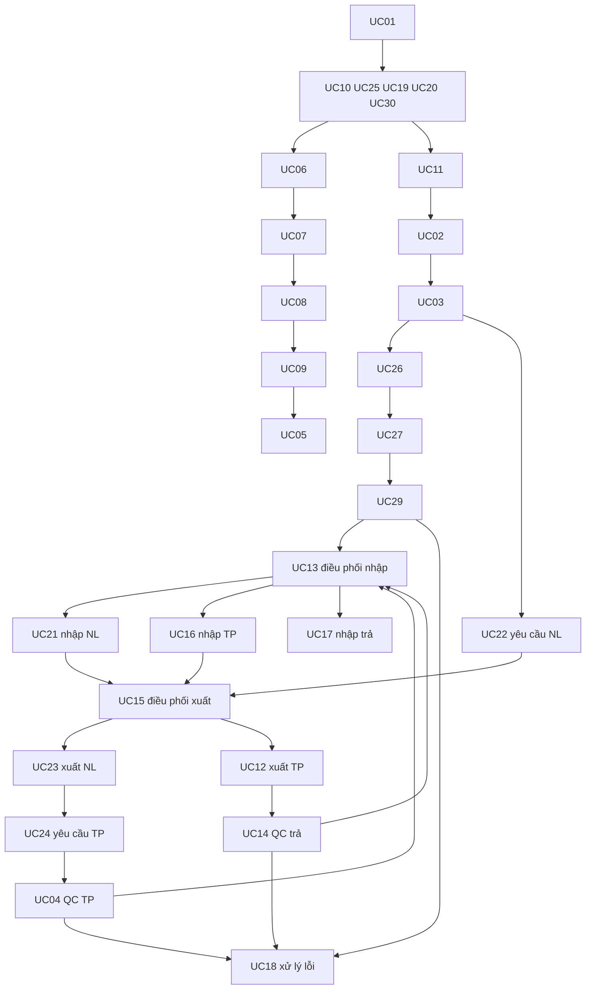

# Phụ thuộc và thứ tự triển khai 29 UC — bản nháp

Lệnh15/10/2026 giao toàn bộ29UC trong một nhiệm vụ, triển khai liên tục theo thứ tự phụ thuộc dưới đây; không dừng từng UC hoặc xin giao từng UC. Không chạy unit/integration/E2E/regression trong đợt code này; hướng dẫn test/fixtures dưới đây là kế hoạch cho giai đoạn kiểm sau. UC13/15 vẫn là hai UC độc lập, không tính dùng lại module là UC mới. [Kế hoạch](full_system_execution.md), [policy cần chốt](full_system_policy_approval.md).

## Hai loại phụ thuộc

Phụ thuộc nghiệp vụ là dữ liệu phải hợp lệ khi thao tác, khác phụ thuộc triển khai UI. UC13 triển khai lần đầu trên nhánh NL sau UC29, với fixtures QC TP/hàng trả đúng schema để kiểm toàn contract; khi UC04/14 xong chạy lại integration nhánh đó. UC15 triển khai sau UC22 trên nhánh NL, fixture TP/order đã có; UC16 sau đó mở dữ liệu thật cho UC12. Không tạo controller giả hoặc âm thầm triển khai UC chưa giao để vượt vòng phụ thuộc.

Các danh mục hỗ trợ NCC/xưởng/định mức/quyền/unit được seed hạ tầng sau duyệt; màn CRUD ngoài UC phải được D11 duyệt. UC06 có thể nghiệm thu tra cứu trên fixtures ledger/balance, sau posting UC khác kiểm regression với dữ liệu thật.

| Thứ tự | UC/tên | Phụ thuộc nghiệp vụ/dữ liệu | Gói FE/BE/DB/test |
|---|---|---|---|
| 1 | UC01 – Đăng nhập hệ thống | — | [gói UC01](uc_catalog.md); FE /login (mới), BE auth.login, DB TaiKhoan/VaiTroQuyen/session, test Sai mật khẩu/locked |
| 2 | UC10 – Quản lý nguyên liệu | UC01 | [gói UC10](uc_catalog.md); FE /materials/catalog (mới), BE materials.*, DB NguyenLieu/DonViTinh, test Mã trùng/xóa đã dùng |
| 3 | UC25 – Quản lý thành phẩm | UC01 | [gói UC25](uc_catalog.md); FE /finished-goods/catalog (mới), BE products.*, DB ThanhPham/QuyCachDongGoi, test Hệ số sai/version đã dùng |
| 4 | UC19 – Quản lý dữ liệu kho | UC01 | [gói UC19](uc_catalog.md); FE /storage-locations, BE warehouses.*, DB Kho/ViTriLuuKho, test Xóa vị trí có tồn/đơn vị sai |
| 5 | UC30 – Quản lý lô nguyên liệu | UC10, UC19 | [gói UC30](uc_catalog.md); FE /lots?type=material, BE materialLots.*, DB LoNguyenLieu, test HSD<NSX/xóa lô đã dùng |
| 6 | UC20 – Quản lý lô thành phẩm | UC25, UC19 | [gói UC20](uc_catalog.md); FE /lots?type=product, BE productLots.*, DB LoThanhPham, test HSD sai/xóa lô đã dùng |
| 7 | UC06 – Tra cứu dữ liệu kho | UC19, UC20, UC30 | [gói UC06](uc_catalog.md); FE /reports (tra cứu), BE inventory.search, DB balance/ledger/chứng từ (read), test Filter sai/ID ngoài scope/rỗng |
| 8 | UC11 – Đặt đơn hàng | UC25 | [gói UC11](uc_catalog.md); FE /orders (mới), BE orders.*, DB DonHang/ChiTietDonHang, test Lượng sai/SKU khóa/đơn khách khác |
| 9 | UC02 – Lập kế hoạch sản xuất | UC11, UC10, UC25 | [gói UC02](uc_catalog.md); FE /production-plans; /workshop-assignments, BE plans.*, DB KHSX/CTKHSX/định mức/nhu cầu, test Lượng âm/trùng lịch/vượt năng lực |
| 10 | UC03 – Duyệt KHSX | UC02 | [gói UC03](uc_catalog.md); FE /production-plans/:id, BE plans.decide, DB KHSX/nhu cầu/audit, test Duyệt lặp/snapshot nhu cầu sai |
| 11 | UC26 – Lập đơn mua NL | UC03, UC10 | [gói UC26](uc_catalog.md); FE /purchases (mới), BE purchases.*, DB PO/chi tiết/NCC/phân bổ nhu cầu, test Thiếu NCC/chi tiết/đặt trùng nhu cầu |
| 12 | UC27 – Duyệt đơn mua NL | UC26 | [gói UC27](uc_catalog.md); FE /purchases/:id, BE purchases.decide, DB PO/audit, test Duyệt lặp/sai role |
| 13 | UC29 – QC nguyên liệu | UC27, UC30 | [gói UC29](uc_catalog.md); FE /materials/qc, BE materialQc.*, DB giao NL/QC header/detail, test Tổng QC sai/kiểm trùng/quá nhận |
| 14 | UC13 – Điều phối nhập kho | UC29 hoặc UC04 hoặc UC14; UC19 | [gói UC13](uc_catalog.md); FE /materials/receipts và /finished-goods/receipts, bước điều phối, BE receipts.allocate, receipts.confirmAllocation, DB PNK/chi tiết/coordinator/version/audit, test Vượt QC/capacity/stale/scope |
| 15 | UC21 – Nhập kho nguyên liệu | UC13 (nguồn UC29) | [gói UC21](uc_catalog.md); FE /materials/receipts, BE receipts.postMaterial, DB PNK/QC NL/balance/posting/ledger, test Hai nhập tranh quota/rollback/capacity |
| 16 | UC22 – Lập yêu cầu xuất NL | UC03, UC10 | [gói UC22](uc_catalog.md); FE /material-requests (mới), BE materialRequests.*, DB request NL/detail/nhu cầu, test Vượt định mức/sai xưởng |
| 17 | UC15 – Điều phối xuất kho | UC11 hoặc UC22; tồn hợp lệ UC16/21/17 | [gói UC15](uc_catalog.md); FE /materials/issues và /finished-goods/issues, bước điều phối, BE issues.allocate, issues.confirmAllocation, DB PXK/chi tiết/DatGiuTon/reserved/coordinator/version/audit, test tranh hold/FEFO/expiry/cancel/consume không trừ hai lần |
| 18 | UC23 – Xuất kho NL | UC15 (nguồn UC22) | [gói UC23](uc_catalog.md); FE /materials/issues, BE issues.postMaterial, DB PXK/request NL/balance/ledger, test Hai xuất cùng lô/overfulfill/rollback |
| 19 | UC24 – Lập yêu cầu nhập TP | UC03, UC20; UC23 tùy điều kiện sản xuất | [gói UC24](uc_catalog.md); FE /finished-goods-requests (mới), BE productRequests.*, DB request TP/detail/lô hoàn thành, test Thiếu lô/vượt lượng nguồn/sai xưởng |
| 20 | UC04 – QC thành phẩm | UC24 | [gói UC04](uc_catalog.md); FE /finished-goods/qc (mới), BE productQc.*, DB QC TP/detail/request, test accepted+rejected sai/quá nhận |
| 21 | UC16 – Nhập kho TP | UC13 (nguồn UC04) | [gói UC16](uc_catalog.md); FE /finished-goods/receipts, BE receipts.postProduct, DB PNK/QC TP/balance/ledger, test Nhập trùng/vượt đạt/stale/rollback |
| 22 | UC12 – Xuất kho TP giao hàng | UC15 (nguồn UC11) | [gói UC12](uc_catalog.md); FE /finished-goods/issues, BE issues.postSale, DB PXK/order lines/balance/ledger, test Lô hết hạn/hold/xuất cạnh tranh |
| 23 | UC14 – Kiểm tra hàng trả về | UC12; tiếp nhận trả D05/D12 | [gói UC14](uc_catalog.md); FE /returns/qc (mới), BE returnQc.*, DB yêu cầu trả/detail/QC/quarantine, test Không rõ lô/số trả vượt giao/seal lỗi |
| 24 | UC17 – Nhập kho hàng trả | UC13 (nguồn UC14) | [gói UC17](uc_catalog.md); FE /returns/receipts (mới), BE receipts.postReturn, DB PNK/return QC/quarantine/balance/ledger, test Chưa QC/quota vượt/capacity/rollback |
| 25 | UC18 – Xử lý hàng lỗi/trả về | UC04 hoặc UC29 hoặc UC14; quyền duyệt D05 | [gói UC18](uc_catalog.md); FE /defective-goods (mới), BE dispositions.*, DB xử lý lỗi/approval/stock docs/ledger, test Không duyệt/quá lượng lỗi/nhầm restock |
| 26 | UC07 – Lập biên bản kiểm kê | UC19, UC20, UC30; balance/ledger hợp lệ | [gói UC07](uc_catalog.md); FE /inventory-counts, BE stocktakes.*, DB biên bản/scope lock/snapshot/count, test Vị trí trống/hàng thừa/AC-KK01–04,08–10 |
| 27 | UC08 – Xử lý chênh lệch kiểm kê | UC07 | [gói UC08](uc_catalog.md); FE /inventory-counts/:id/variances, BE variances.verify, DB xác minh/evidence/đề nghị/count lại, test Thiếu evidence/sai thời điểm/AC-KK07,09 |
| 28 | UC09 – Phê duyệt điều chỉnh tồn | UC08 | [gói UC09](uc_catalog.md); FE /inventory-counts/:id/adjustments, BE adjustments.decide, DB đề nghị/balance/posting/ledger, test AC-KK05/06, duyệt cạnh tranh/rollback |
| 29 | UC05 – Thống kê báo cáo và cảnh báo | UC06, UC09 và giao dịch UC12/16/17/21/23/18 | [gói UC05](uc_catalog.md); FE /reports; /dashboard, BE reports.*, DB balance/ledger/alerts (read/config), test Không dữ liệu/quarantine lẫn DAT/mixed units |

Sơ đồ có vòng dữ liệu qua UC13/15 vì module điều phối tái sử dụng cho nhiều nguồn; không cần fake endpoint để vượt vòng. Toàn bộ nguồn thật được triển khai trong cùng nhiệm vụ. Quy trình mới: code đủ FE/BE/DB/RBAC từng UC → DA_CODE_CHUA_TEST và tiếp tục UC kế → bàn giao toàn bộ để người dùng kiểm/nghiệm thu. Không chạy bộ test hoặc dừng chờ giữa các UC; các yêu cầu regression/fixtures lịch sử dành cho giai đoạn kiểm sau.

## Fixtures cho chính sách đã xác nhận

Sau duyệt nền tảng, seed BOM versions/effective dates, capacity factors, delivery thành công và quarantine reception theo FK đúng; không mock handler cho UC chưa code. UC13 đầu tiên test QC NL thật và QC TP/return fixtures; capacity reservation không bật khi CHUA_DUYET. UC15 đầu tiên test giữ NL thật/hold+source quotas và sale fixtures, không chờ UC16 gây vòng code. UC07 seed lease hữu hạn/generation/stock ledger; không giữ locks vô hạn vì policy chưa chốt. UC14 cần delivery-confirmed fixture thay vì coi UC12 post đã giao. UC02 cần BOM và xưởng seed; CRUD hỗ trợ CHUA_DUYET. Khi UC nguồn hoàn thành chạy chuỗi thật để nghiệm thu tích hợp.

Thứ tự29 mã giữ nguyên: UC01→UC10→UC25→UC19→UC30→UC20→UC06→UC11→UC02→UC03→UC26→UC27→UC29→UC13→UC21→UC22→UC15→UC23→UC24→UC04→UC16→UC12→UC14→UC17→UC18→UC07→UC08→UC09→UC05. Người dùng đã giao cả chuỗi15/10; tiếp tục liên tục khi các điểm nghiệp vụ chặn được chốt.
